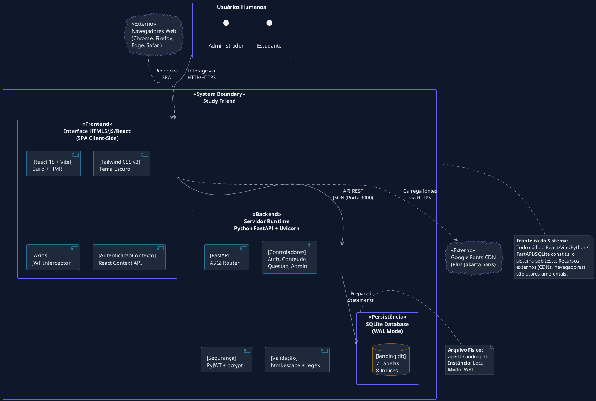
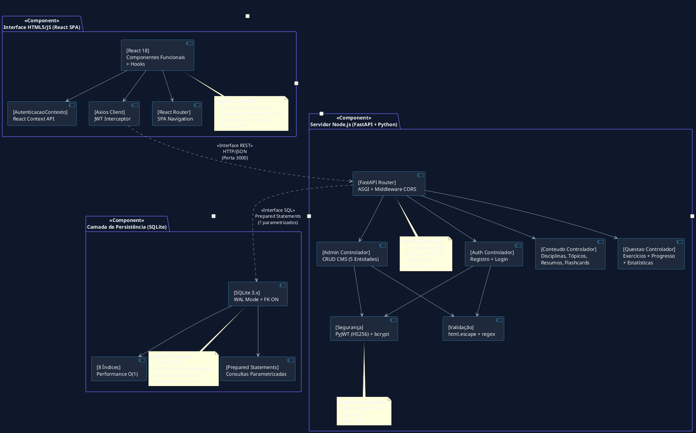
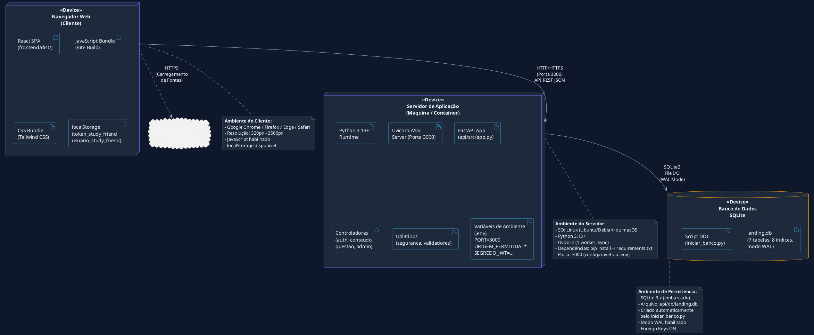

# Escopo do Projeto — Study Friend

**Projeto:** Plataforma Estudantil Integrada *Study Friend*
**Padrão de Gerenciamento:** PMBOK 7ª Edição & UML 2.5.1 (ISO/IEC 19505)
**Modelo de Qualidade:** FURPS+ / ISO/IEC 25010
**Versão:** 2.0.0
**Data:** 03 de Setembro de 2026
**Status:** Aprovado / Baseline de Projeto
**Autor:** Engenharia de Software & Arquitetura UML

---

## 1. Justificativa de Engenharia e Objetivos SMART

### 1.1 Contexto e Justificativa

A plataforma educacional brasileira enfrenta desafios significativos na preparação de estudantes do Ensino Médio para vestibulares e ENEM. A fragmentação de recursos de estudo em múltiplas fontes não integradas gera ineficiência pedagógica, falta de acompanhamento individualizado e baixa retenção de conteúdo. Estudos indicam que a prática ativa (*active recall*) e a revisão espaçada (*spaced repetition*) são métodos comprovadamente eficazes para fixação de conhecimento, mas raramente estão disponíveis em plataformas integradas e acessíveis.

O **Study Friend** surge como solução full-stack para consolidar resumos didáticos, flashcards de revisão ativa e banco de exercícios em uma única plataforma web com interface limpa em tema escuro, autenticação segura (JWT), dashboard analítico de desempenho e painel administrativo para gestão pedagógica. A arquitetura adota tecnologias maduras e amplamente documentadas:

- **Frontend:** React 18 (componentização, Hooks, Context API), Vite (HMR, build otimizado), Tailwind CSS v3 (utilitários CSS Mobile-First).
- **Backend:** Python 3 + FastAPI (framework async de alta performance, documentação automática OpenAPI), Uvicorn (servidor ASGI).
- **Persistência:** SQLite com modo WAL (*Write-Ahead Logging*) para concorrência de leitura.
- **Segurança:** PyJWT (autenticação stateless), bcrypt (hashing de senhas), sanitização `html.escape`.

### 1.2 Objetivos SMART

| Objetivo | Descrição | Métrica | Prazo |
|:---------|:----------|:--------|:------|
| **S — Específico** | Disponibilizar plataforma web educacional funcional com 9 disciplinas (agrupadas em 4 áreas separadas com ícones), flashcards, exercícios e dashboard | 9 disciplinas × 26 tópicos × resumos + flashcards + questões | MVP funcionando |
| **M — Mensurável** | Alcançar cobertura de conteúdo para todas as disciplinas do Ensino Médio com no mínimo 1 resumo, 1 flashcard e 1 questão por tópico | 26 tópicos cobertos, 26 resumos, 36 flashcards, 26 questões | Entrega inicial |
| **A — Alcançável** | Desenvolver com stack tecnológica de baixo custo e curva de aprendizado acessível para equipe acadêmica | React + FastAPI + SQLite | Equipe disponível |
| **R — Relevante** | Fornecer ferramenta que melhore a experiência de estudo e permita acompanhamento de desempenho por disciplina | Dashboard com taxa de acerto por matéria | Funcional |
| **T — Temporal** | Entregar MVP funcional dentro do semestre letivo vigente | Deploy em produção até final do semestre | 4 meses |

---

## 2. Delimitação das Fronteiras do Sistema (System Boundary)

### 2.1 Diagrama de Contexto em PlantUML

Este diagrama de contexto (C4 Level 1) delimita as fronteiras do sistema **Study Friend**, isolando a interface do cliente, o servidor runtime, a persistência e recursos externos/CDNs.



### 2.2 Ativos do Sistema (System Assets)

| Ativo | Localização | Descrição |
|:------|:------------|:----------|
| **Frontend React** | `frontend/src/` | Componentes React, páginas, contextos, serviços |
| **Backend FastAPI** | `api/src/` | Rotas, controladores, configurações, utilitários |
| **Banco de Dados** | `api/db/landing.db` | Arquivo SQLite com 7 tabelas e dados semeados |
| **Script de DDL** | `api/iniciar_banco.py` | Criação de tabelas e seed de dados pedagógicos |
| **Configurações** | `api/.env` | Variáveis de ambiente (porta, CORS, segredo JWT) |
| **Build de Produção** | `frontend/dist/` | Bundle otimizado gerado pelo Vite |

### 2.3 Atores Ambientais (Atores Externos ao Sistema)

| Ator Ambiental | Tipo | Interação |
|:---------------|:-----|:----------|
| **Estudante** | Humano | Acessa a interface web via navegador para estudar |
| **Administrador** | Humano | Acessa o Painel CMS para gerenciar conteúdo |
| **Navegador Web** | Software | Renderiza a SPA React, executa JavaScript |
| **Google Fonts CDN** | Serviço | Fornece a fonte Plus Jakarta Sans |
| **Sistema Operacional** | Software | Executa o processo Python/Uvicorn e gerencia o arquivo SQLite |

---

## 3. Escopo do Produto por Módulos Arquiteturais

### 3.1 Módulo de Autenticação e Segurança

| Entregável | Arquivo(s) | Descrição |
|:-----------|:-----------|:----------|
| Rota de Registro | `api/src/rotas/auth_rotas.py` | `POST /api/auth/registrar` |
| Rota de Login | `api/src/rotas/auth_rotas.py` | `POST /api/auth/login` |
| Controlador de Auth | `api/src/controladores/auth_controlador.py` | Lógica de registro, validação e login |
| Módulo de Segurança | `api/src/utilitarios/seguranca.py` | bcrypt hash, JWT encode/decode (HS256, 12h) |
| Módulo de Validação | `api/src/utilitarios/validadores.py` | `html.escape()`, regex email |
| Dependência JWT | `api/src/config/dependencias.py` | `obter_usuario_atual()`, `exigir_admin()` |
| Contexto React | `frontend/src/contextos/AutenticacaoContexto.jsx` | Estado global de autenticação |
| Cliente Axios | `frontend/src/servicos/api.js` | Interceptor JWT + tratamento 401 |
| Página Login | `frontend/src/pages/Login.jsx` | Formulário de login |
| Página Registro | `frontend/src/pages/Registrar.jsx` | Formulário de cadastro |

### 3.2 Módulo de Conteúdo e Navegação Pedagógica

| Entregável | Arquivo(s) | Descrição |
|:-----------|:-----------|:----------|
| Rota de Conteúdo | `api/src/rotas/conteudo_rotas.py` | `GET /api/disciplinas`, `/topicos`, `/resumos`, `/flashcards` |
| Controlador de Conteúdo | `api/src/controladores/conteudo_controlador.py` | Queries com JOIN e subcontagens |
| Página Início | `frontend/src/pages/Inicio.jsx` | Hero + grid de disciplinas |
| Hub de Disciplinas | `frontend/src/pages/HubDisciplinas.jsx` | Disciplinas agrupadas por área (Exatas, Humanas, Biológicas, Linguagens) com ícones |
| Página de Tópicos | `frontend/src/pages/PaginaTopicos.jsx` | Lista de tópicos com filtro por ano |
| Visualizador de Resumos | `frontend/src/pages/VisualizadorResumos.jsx` | Renderização de Markdown |

### 3.3 Módulo de Flashcards

| Entregável | Arquivo(s) | Descrição |
|:-----------|:-----------|:----------|
| Rota de Flashcards | `api/src/rotas/conteudo_rotas.py` | `GET /api/topicos/{id}/flashcards` |
| Controlador | `api/src/controladores/conteudo_controlador.py` | Query de flashcards por tópico |
| Módulo Flashcards | `frontend/src/pages/ModuloFlashcards.jsx` | Flip 3D com rotateY, preserve-3d |

### 3.4 Módulo de Banco de Exercícios

| Entregável | Arquivo(s) | Descrição |
|:-----------|:-----------|:----------|
| Rota de Questões | `api/src/rotas/questao_rotas.py` | `GET /api/questoes`, `POST /api/questoes/responder` |
| Rota de Estatísticas | `api/src/rotas/questao_rotas.py` | `GET /api/aluno/estatisticas` |
| Controlador de Questões | `api/src/controladores/questao_controlador.py` | Filtros dinâmicos, UPSERT de progresso |
| Banco de Exercícios | `frontend/src/pages/BancoExercicios.jsx` | Formulário de resposta + feedback |
| Dashboard | `frontend/src/pages/Dashboard.jsx` | Métricas e barras de progresso |

### 3.5 Módulo Administrativo CMS

| Entregável | Arquivo(s) | Descrição |
|:-----------|:-----------|:----------|
| Rotas Admin | `api/src/rotas/admin_rotas.py` | 20 endpoints CRUD protegidos por ADMIN |
| Controlador Admin | `api/src/controladores/admin_controlador.py` | CRUD para 5 entidades com sanitização |
| Painel CMS | `frontend/src/pages/AdminCMS.jsx` | Interface de abas para gerenciamento |

### 3.6 Módulo de Persistência

| Entregável | Arquivo(s) | Descrição |
|:-----------|:-----------|:----------|
| Script DDL | `api/iniciar_banco.py` | Criação de 7 tabelas + 8 índices + seed |
| Configuração DB | `api/src/config/conexao_banco.py` | Conexão SQLite com WAL e row_factory dict |
| Banco de Dados | `api/db/landing.db` | Arquivo SQLite (criado em runtime) |

### 3.7 Módulo de Infraestrutura e Build

| Entregável | Arquivo(s) | Descrição |
|:-----------|:-----------|:----------|
| Configuração FastAPI | `api/src/app.py` | App, CORS, routers, SPA fallback |
| Ponto de Entrada | `api/main.py` | Inicialização do Uvicorn (porta 3000) |
| Config Vite | `frontend/vite.config.js` | HMR, proxy de API, config de build |
| Config Tailwind | `frontend/tailwind.config.js` | Scan de conteúdo, tema padrão |
| Config PostCSS | `frontend/postcss.config.js` | Plugins tailwindcss + autoprefixer |
| Dependências Python | `api/requirements.txt` | fastapi, uvicorn, pydantic, bcrypt, PyJWT |
| Dependências React | `frontend/package.json` | react, react-dom, axios + devDeps |
| Variáveis de Ambiente | `api/.env.example` | PORT, ORIGEM_PERMITIDA, SEGREDO_JWT |

---

## 4. Diagrama de Componentes UML 2.5.1 com Portas e Interfaces



### 4.1 Descrição das Portas e Interfaces

| Interface | Tipo | Provedor | Requerente | Contrato |
|:----------|:-----|:---------|:-----------|:---------|
| **REST API (HTTP/JSON)** | `<<interface>>` | FastAPI Backend | React Frontend (Axios) | JSON payloads via HTTP, autenticação Bearer JWT |
| **SQL (Prepared Statements)** | `<<interface>>` | SQLite Database | FastAPI Controladores | Consultas parametrizadas com `?`, retorno `dict` via `row_factory` |
| **JWT Auth (encode/decode)** | `<<interface>>` | Módulo `seguranca.py` | Controladores Auth/Admin | `criar_token_jwt()`, `decodificar_token_jwt()` |
| **Sanitização (escape)** | `<<interface>>` | Módulo `validadores.py` | Todos os Controladores | `sanitizar(texto)`, `e_email_valido(email)` |
| **Context API (React)** | `<<interface>>` | `AutenticacaoContexto` | Páginas React | `login()`, `registrar()`, `logout()`, `usuario`, `autenticado` |
| **Vite Dev Proxy** | `<<interface>>` | Vite Config | Frontend Dev | Proxy `/api` → `http://localhost:3000` |

---

## 5. Diagrama de Implantação (Deployment Diagram)



### 5.1 Mapeamento de Variáveis de Ambiente

| Variável | Localização | Valor Padrão | Descrição |
|:---------|:------------|:-------------|:----------|
| `PORT` | `api/.env` | `3000` | Porta do servidor Uvicorn |
| `ORIGEM_PERMITIDA` | `api/.env` | `*` | Origem CORS permitida |
| `SEGREDO_JWT` | `api/.env` | `segredo-study-friend-desenvolvimento` | Segredo HMAC-SHA256 para JWT |
| `VITE_API_URL` | `frontend/vite.config.js` | `/api` (proxy para `localhost:3000`) | URL da API no desenvolvimento |

---

## 6. Estrutura Analítica do Projeto (EAP / WBS)

```
1. Estudo Friend — Plataforma Estudantil Integrada
│
├── 1.1 Gerenciamento de Projeto
│   ├── 1.1.1 Documentação de Requisitos
│   │   ├── 1.1.1.1 requisitos_de_usuario.md (RU, Casos de Uso, Histórias)
│   │   ├── 1.1.1.2 requisitos_de_sistema.md (RFS, Contratos REST, DDL)
│   │   └── 1.1.1.3 escopo_do_projeto.md (Este documento)
│   ├── 1.1.2 Planejamento e Cronograma
│   │   ├── 1.1.2.1 Definição de marcos (milestones)
│   │   └── 1.1.2.2 Alocação de recursos
│   └── 1.1.3 Controle de Mudanças
│       ├── 1.1.3.1 Processo de Change Request
│       └── 1.1.3.2 Aprovação de escopo
│
├── 1.2 Backend (Python FastAPI + SQLite)
│   ├── 1.2.1 Infraestrutura
│   │   ├── 1.2.1.1 api/main.py (Ponto de entrada Uvicorn)
│   │   ├── 1.2.1.2 api/src/app.py (Configuração FastAPI, CORS, rotas)
│   │   ├── 1.2.1.3 api/.env.example (Template de variáveis)
│   │   └── 1.2.1.4 api/requirements.txt (Dependências Python)
│   ├── 1.2.2 Configuração e Conexão
│   │   ├── 1.2.2.1 api/src/config/conexao_banco.py (SQLite WAL + dict_factory)
│   │   └── 1.2.2.2 api/src/config/dependencias.py (JWT auth + admin guard)
│   ├── 1.2.3 Rotas (API REST)
│   │   ├── 1.2.3.1 api/src/rotas/auth_rotas.py (Registro + Login)
│   │   ├── 1.2.3.2 api/src/rotas/conteudo_rotas.py (Disciplinas, Tópicos, Resumos, Flashcards)
│   │   ├── 1.2.3.3 api/src/rotas/questao_rotas.py (Questões + Estatísticas)
│   │   ├── 1.2.3.4 api/src/rotas/admin_rotas.py (20 endpoints CRUD)
│   │   └── 1.2.3.5 api/src/rotas/lead_rotas.py (Legado)
│   ├── 1.2.4 Controladores (Business Logic)
│   │   ├── 1.2.4.1 api/src/controladores/auth_controlador.py
│   │   ├── 1.2.4.2 api/src/controladores/conteudo_controlador.py
│   │   ├── 1.2.4.3 api/src/controladores/questao_controlador.py
│   │   ├── 1.2.4.4 api/src/controladores/admin_controlador.py
│   │   └── 1.2.4.5 api/src/controladores/lead_controlador.py (Legado)
│   ├── 1.2.5 Utilitários
│   │   ├── 1.2.5.1 api/src/utilitarios/seguranca.py (JWT + bcrypt)
│   │   └── 1.2.5.2 api/src/utilitarios/validadores.py (Sanitização + validação)
│   └── 1.2.6 Banco de Dados
│       ├── 1.2.6.1 api/iniciar_banco.py (DDL + seed de 9 disciplinas, 26 tópicos, 26 resumos, 36 flashcards, 26 questões, 1 admin)
│       └── 1.2.6.2 api/db/landing.db (Arquivo SQLite criado em runtime)
│
├── 1.3 Frontend (React 18 + Vite + Tailwind CSS)
│   ├── 1.3.1 Infraestrutura
│   │   ├── 1.3.1.1 frontend/package.json
│   │   ├── 1.3.1.2 frontend/vite.config.js (HMR + proxy API)
│   │   ├── 1.3.1.3 frontend/tailwind.config.js
│   │   ├── 1.3.1.4 frontend/postcss.config.js
│   │   └── 1.3.1.5 frontend/index.html (Ponto de entrada SPA)
│   ├── 1.3.2 Core da Aplicação
│   │   ├── 1.3.2.1 frontend/src/main.jsx (ReactDOM.createRoot)
│   │   ├── 1.3.2.2 frontend/src/App.jsx (SPA Router + navegação)
│   │   ├── 1.3.2.3 frontend/src/index.css (Estilos globais + glassmorphism)
│   │   ├── 1.3.2.4 frontend/src/contextos/AutenticacaoContexto.jsx
│   │   └── 1.3.2.5 frontend/src/servicos/api.js (Axios interceptor)
│   ├── 1.3.3 Componentes
│   │   ├── 1.3.3.1 frontend/src/components/Navbar.jsx (Barra com logo.png)
│   │   ├── 1.3.3.2 frontend/src/components/Toast.jsx
│   │   ├── 1.3.3.3 frontend/src/components/IconeDisciplina.jsx (Ícones SVG por matéria)
│   │   └── 1.3.3.4 frontend/src/utilidades/areas.js (Cores e agrupamento por área)
│   ├── 1.3.4 Páginas
│   │   ├── 1.3.4.1 frontend/src/pages/Inicio.jsx (Hero + disciplinas)
│   │   ├── 1.3.4.2 frontend/src/pages/HubDisciplinas.jsx (Disciplinas por área + ícones)
│   │   ├── 1.3.4.3 frontend/src/pages/PaginaTopicos.jsx (Tópicos + filtro ano)
│   │   ├── 1.3.4.4 frontend/src/pages/VisualizadorResumos.jsx (Markdown viewer)
│   │   ├── 1.3.4.5 frontend/src/pages/ModuloFlashcards.jsx (Flip 3D)
│   │   ├── 1.3.4.6 frontend/src/pages/BancoExercicios.jsx (Questões + feedback)
│   │   ├── 1.3.4.7 frontend/src/pages/Dashboard.jsx (Estatísticas)
│   │   ├── 1.3.4.8 frontend/src/pages/Login.jsx
│   │   ├── 1.3.4.9 frontend/src/pages/Registrar.jsx
│   │   └── 1.3.4.10 frontend/src/pages/AdminCMS.jsx (CRUD abas)
│
└── 1.4 Documentação
    ├── 1.4.1 README.md (Documentação principal do repositório)
    ├── 1.4.2 doc/escopo_do_projeto.md
    ├── 1.4.3 doc/requisitos_de_sistema.md
    └── 1.4.4 doc/requisitos_de_usuario.md
```

### 6.1 Dicionário de Entregáveis

| Entregável | Tipo | Linhas | Descrição Resumida |
|:-----------|:-----|:-------|:-------------------|
| `api/main.py` | Python | ~10 | Ponto de entrada Uvicorn, porta 3000 |
| `api/src/app.py` | Python | 71 | Configuração FastAPI, CORS, routers, SPA fallback |
| `api/src/config/conexao_banco.py` | Python | 20 | Fábrica de conexão SQLite WAL com dict_factory |
| `api/src/config/dependencias.py` | Python | 42 | Dependências FastAPI: JWT auth + admin guard |
| `api/src/rotas/auth_rotas.py` | Python | 25 | 2 endpoints: registro e login |
| `api/src/rotas/conteudo_rotas.py` | Python | 34 | 4 endpoints: disciplinas, tópicos, resumos, flashcards |
| `api/src/rotas/questao_rotas.py` | Python | 45 | 3 endpoints: questões, responder, estatísticas |
| `api/src/rotas/admin_rotas.py` | Python | 173 | 20 endpoints CRUD para 5 entidades |
| `api/src/controladores/auth_controlador.py` | Python | 102 | Validação, hash bcrypt, geração JWT |
| `api/src/controladores/conteudo_controlador.py` | Python | 87 | Queries JOIN com subcontagens |
| `api/src/controladores/questao_controlador.py` | Python | 154 | Filtros dinâmicos, UPSERT, agregações |
| `api/src/controladores/admin_controlador.py` | Python | 277 | CRUD completo com sanitização |
| `api/src/utilitarios/seguranca.py` | Python | 40 | bcrypt + PyJWT (HS256, 12h) |
| `api/src/utilitarios/validadores.py` | Python | 43 | html.escape + regex email + validação lead |
| `api/iniciar_banco.py` | Python | 417 | DDL + seed completo (9 disciplinas, 26 tópicos, etc.) |
| `frontend/src/App.jsx` | JSX | 108 | SPA Router + navegação via useState |
| `frontend/src/contextos/AutenticacaoContexto.jsx` | JSX | 63 | Estado global de autenticação |
| `frontend/src/servicos/api.js` | JS | 32 | Axios com interceptor JWT |
| `frontend/src/pages/*.jsx` | JSX | 10 arquivos | 10 páginas da aplicação |
| `frontend/src/components/*.jsx` | JSX | 2 arquivos | Navbar e Toast |

---

## 7. Limites Explícitos do Projeto

### 7.1 Dentro do Escopo (In-Scope)

| # | Item | Descrição |
|:--|:-----|:----------|
| 1 | Frontend React 18 SPA | 10 páginas funcionais com navegação SPA, tema escuro minimalista |
| 2 | Backend FastAPI RESTful | 30+ endpoints com autenticação JWT, RBAC, sanitização XSS |
| 3 | Banco SQLite WAL | 7 tabelas com constraints CHECK/UNIQUE, 8 índices, foreign keys CASCADE |
| 4 | Conteúdo Pedagógico MVP | 9 disciplinas, 26 tópicos, 26 resumos, 36 flashcards, 26 questões semeadas |
| 5 | Autenticação JWT | Registro, login, token HS256 (12h), interceptor Axios, RBAC |
| 6 | Dashboard Analítico | Métricas de desempenho por disciplina com barras de progresso |
| 7 | Painel CMS Admin | CRUD completo para disciplinas, tópicos, resumos, flashcards e questões |
| 8 | Flashcards Flip 3D | Animação CSS com rotateY, preserve-3d, backface-visibility |
| 9 | Validação e Sanitização | html.escape contra XSS, regex email, Prepared Statements contra SQL Injection |
| 10 | Build de Produção | Vite build → frontend/dist/, servido via FastAPI StaticFiles |
| 11 | Documentação Técnica | Requisitos de Usuário, Requisitos de Sistema, Escopo do Projeto |
| 12 | Variáveis de Ambiente | Configuração via .env (porta, CORS, segredo JWT) |

### 7.2 Fora do Escopo (Out-of-Scope)

| # | Item | Justificativa |
|:--|:-----|:--------------|
| 1 | Aplicativo Mobile Nativo (iOS/Android) | Requer stack tecnológica completamente diferente (React Native, Swift, Kotlin) |
| 2 | Sistema de Pagamentos / Assinatura | Modelo de negócio freemium não definido neste fase |
| 3 | Chat em Tempo Real / WebSocket | Requer infraestrutura de mensageria (Redis, Socket.IO) |
| 4 | Sistema de Notificações Push / Email | Requer integração com serviços externos (Firebase, SendGrid) |
| 5 | Inteligência Artificial / Recomendação | Requer treinamento de modelos e dados históricos em volume |
| 6 | Testes Automatizados (Unit/Integration) | Framework de testes (pytest, Jest) não implementado no MVP |
| 7 | CI/CD Pipeline | Integração contínua e deploy automático não configurados |
| 8 | Migração para PostgreSQL | SQLite chosen for MVP simplicity; migration requires ORM refactor |
| 9 | Multi-idioma (Internacionalização i18n) | Sistema destinado exclusivamente ao público brasileiro |
| 10 | Auditoria de Logs / Monitoramento | Ferramentas como Sentry, ELK ou Prometheus não integradas |
| 11 | Cache Redis / CDN de Assets | Infraestrutura de cache distribuído não implementada |
| 12 | Sistema de Backup Automático | backup do banco SQLite deve ser feito manualmente ou via cron |
| 13 | Testes de Penetração / Segurança | Auditoria OWASP formal não realizada |
| 14 | Conformidade LGPD Formal | Política de privacidade e consentimento de dados não implementados |
| 15 | Suporte a Navegadores Legacy | IE11, Edge Legacy não suportados |

---

## 8. Matrizes de Controle do Projeto

### 8.1 Matriz de Critérios de Aceitação (CA)

| # | Critério de Aceitação | Método de Verificação | Status |
|:--|:----------------------|:----------------------|:-------|
| CA-01 | 9 disciplinas exibidas no Hub, agrupadas por área (Exatas, Humanas, Biológicas, Linguagens) e com ícone identificador | Teste visual + inspeção de `GET /api/disciplinas` | Pendente |
| CA-02 | Login funcional com retorno de JWT válido (12h expiração) | Teste de integração `POST /api/auth/login` + decodificação JWT | Pendente |
| CA-03 | Cadastro de estudante com validação client-side e server-side | Teste com dados inválidos (senha curta, e-mail duplicado) | Pendente |
| CA-04 | Flashcards com animação Flip 3D funcional | Teste visual em Chrome/Firefox | Pendente |
| CA-05 | Questões respondidas registradas em `progresso_aluno` via UPSERT | Verificação direta no banco SQLite | Pendente |
| CA-06 | Dashboard exibe métricas corretas (taxa de acerto, por disciplina) | Teste com dados semeados + cálculo manual | Pendente |
| CA-07 | Painel CMS permite CRUD completo para 5 entidades | Teste de criação, edição e exclusão em cada aba | Pendente |
| CA-08 | Rotas admin retornam 403 para não-ADMIN | Teste com token de estudante em `/api/admin/*` | Pendente |
| CA-09 | Sanitização XSS funciona (payload `<script>` armazenado como `&lt;script&gt;`) | Teste com injeção de código via formulário | Pendente |
| CA-10 | Layout responsivo de 320px a 2560px | Teste em Chrome DevTools com múltiplas resoluções | Pendente |
| CA-11 | Build de produção gerado em `frontend/dist/` e servido via FastAPI | Execução de `npm run build` + verificação de arquivos estáticos | Pendente |
| CA-12 | Tempo de resposta GET < 150ms em 95% dos casos | Medição via DevTools Network Tab | Pendente |

### 8.2 Matriz de Restrições e Premissas

#### Restrições

| # | Restrição | Tipo | Impacto |
|:--|:----------|:-----|:--------|
| R-01 | Equipe acadêmica com dedicação parcial (máx. 20h/semana) | Humana | Cronograma estendido |
| R-02 | Orçamento zero (tecnologias open-source apenas) | Financeira | Sem licenças comerciais |
| R-03 | SQLite como banco único (sem servidor separado) | Técnica | Limitação de concorrência de escrita |
| R-04 | Frontend sem React Router (navegação via useState) | Técnica | URLs não amigáveis, sem deep linking |
| R-05 | Backend Python (não Node.js como descrito na especificação original) | Técnica | Stack diferente do planejado |
| R-06 | Sem framework de testes automatizados | Técnica | Qualidade depende de testes manuais |
| R-07 | Deploy manual (sem CI/CD) | Processual | Risco de erro em produção |

#### Premissas

| # | Premissa | Validade |
|:--|:---------|:---------|
| P-01 | Os navegadores modernos dos alunos suportam JavaScript ES6+ e CSS3 | Alta |
| P-02 | A internet dos alunos permite carregamento de bundle React (~200KB gzipped) | Média |
| P-03 | O conteúdo pedagógico seed (26 tópicos) é suficiente para o MVP | Média |
| P-04 | O usuário admin padrão (`admin@studyfriend.com`) será alterado em produção | Alta |
| P-05 | O SQLite WAL mode suporta a concorrência esperada (estudantes lendo + admin escrevendo) | Alta |
| P-06 | A equipe possui conhecimento em React, Python e SQLite | Alta |
| P-07 | O deploy será feito em servidor Linux com Python 3.13+ disponível | Alta |

### 8.3 Matriz de Riscos Técnicos com Planos de Mitigação

| # | Risco | Probabilidade | Impacto | Mitigação Arquitetural |
|:--|:------|:-------------|:--------|:-----------------------|
| **RT-01** | **SQLite `database is locked`** em concorrência de escrita | Média | Alto | Modo WAL habilitado (`PRAGMA journal_mode=WAL`). Leituras concorrentes sem bloqueio. Escritas rápidas com `conexao.close()` imediato. Monitorar com testes de carga. |
| **RT-02** | **SQL Injection** via inputs maliciosos | Baixa | Crítico | Todas as queries usam Prepared Statements (`?`). Nenhuma concatenação de strings. Auditoria de código em todos os controladores. |
| **RT-03** | **XSS Stored** via campos de texto do CMS | Média | Alto | `html.escape()` aplicado em todos os inputs antes da persistência. React renderiza como texto (não como HTML perigoso). |
| **RT-04** | **Event Loop Blocking** (Python GIL + operações síncronas SQLite) | Média | Médio | FastAPI é async, mas SQLite é síncrono. Operações de DB são rápidas (queries simples). Para MVP, GIL não é problema. Escalar para PostgreSQL se necessário. |
| **RT-05** | **JWT Secret comprometido** em produção | Baixa | Crítico | Usar `SEGREDO_JWT` longo e aleatório em produção. Nunca commitar `.env`. Rotacionar segredo periodicamente. |
| **RT-06** | **Perda de dados SQLite** (corrupção do arquivo .db) | Baixa | Alto | WAL mode oferece melhor durabilidade. Backup periódico do arquivo `landing.db`. Script `iniciar_banco.py` pode recriar schema + seed. |
| **RT-07** | **Bundle React muito grande** para conexões lentas | Média | Médio | Vite gera code splitting e minificação. gzip no servidor. Lazy loading de páginas pode ser adicionado. |
| **RT-08** | **CORS mal configurado** permitindo ataques CSRF | Baixa | Alto | `ORIGEM_PERMITIDA` configurável. Em produção, restringir a origem específica. JWT Bearer previne CSRF. |
| **RT-09** | **Enumeração de usuários** via mensagens de erro distintas | Média | Médio | Mensagem genérica "E-mail ou senha incorretos" para login. HTTP 409 para e-mail duplicado no registro (aceitável). |
| **RT-10** | **Exclusão em cascata inesperada** (remoção de disciplina remove todo conteúdo) | Média | Alto | `ON DELETE CASCADE` configurado. Interface CMS exibe confirmação em duas etapas antes de exclusão. |

---

## 9. Governança e Processo de Controle de Mudanças de Escopo

### 9.1 Processo de Change Request

Qualquer alteração nos objetivos, entregáveis, prazos ou funcionalidades estipulados neste documento de Escopo deverá seguir o procedimento formal de solicitação de mudança (*Change Request — CR*):

1. **Identificação da Necessidade:** O solicitante identifica a necessidade de mudança e documenta a justificativa.
2. **Submissão do CR:** Preenchimento do formulário de CR com: descrição da mudança, justificativa, impacto estimado.
3. **Análise de Impacto:** A equipe técnica avalia impactos em escopo, cronograma, qualidade e riscos em até 3 dias úteis.
4. **Revisão e Decisão:** O Product Owner / Líder Técnico aprova, rejeita ou posterga a mudança.
5. **Implementação:** Se aprovada, a mudança é implementada e documentada.
6. **Registro:** A CR é registrada no histórico de mudanças do projeto.

### 9.2 Diagrama de Atividades do Processo de Controle de Mudanças (PlantUML)

```plantuml
@startuml
skinparam backgroundColor #0f172a
skinparam defaultFontColor #f1f5f9
skinparam activityBackgroundColor #1e293b
skinparam activityBorderColor #38bdf8
skinparam activityDiamondBackgroundColor #1e293b
skinparam activityDiamondBorderColor #f59e0b
skinparam arrowColor #94a3b8
skinparam swimlaneBackgroundColor #0f172a
skinparam swimlaneBorderColor #6366f1

|Solicitante|
start
:Identificar necessidade\nde mudança de escopo;
:Preencher formulário\nde Change Request (CR)\ncom justificativa;

|Equipe Técnica|
:Receber CR e analisar\nviabilidade técnica;
:Estimar impacto em:\n- Escopo\n- Cronograma\n- Qualidade\n- Riscos;
:Documentar análise\nde impacto em até\n3 dias úteis;

|Product Owner|
if (Aprovar CR?) then (Aprovada)
  :Registrar CR como\n"APROVADA";
  :Atualizar documento\nde Escopo;
  :Comunicar mudança\nà equipe;

  |Equipe Técnica|
  :Implementar a mudança;
  :Testar e validar;
  :Documentar alterações\nno código;

  |Solicitante|
  :Verificar entrega\nda mudança;
  :Confirmar conformidade;
  stop

else (Rejeitada)
  :Registrar CR como\n"REJEITADA";
  :Comunicar decisão\nao solicitante;
  stop

else (Postergada)
  :Registrar CR como\n"POSTERGADA";
  :Adiar para próxima\nrevisão de escopo;
  stop
end

@enduml
```

### 9.3 Regras de Controle de Mudança

| Regra | Descrição |
|:------|:----------|
| **CR-01** | Nenhuma alteração de escopo será implementada sem aprovação formal do Product Owner. |
| **CR-02** | Mudanças que impactem a segurança (OWASP Top 10) devem ser priorizadas e aprovadas imediatamente. |
| **CR-03** | Mudanças que aumentem o escopo devem ter justificativa de valor ao usuário final. |
| **CR-04** | O histórico de CRs deve ser mantido para auditoria e rastreabilidade. |
| **CR-05** | Mudanças recorrentes (3+ CRs para o mesmo módulo) devem triggerar revisão arquitetural. |

---

## 10. Marco do Projeto (Milestones)

| Marco | Descrição | Entregáveis | Critério de Aceite |
|:------|:----------|:------------|:-------------------|
| **M1** | Projeto Aprovado | Documentação de Requisitos e Escopo | Aprovação dos stakeholders |
| **M2** | Backend Funcional | API REST completa com autenticação | 30+ endpoints respondendo corretamente |
| **M3** | Frontend Funcional | 10 páginas React com navegação SPA | Interface responsiva e funcional |
| **M4** | Integração Completa | Frontend + Backend + SQLite integrados | Fluxo ponta a ponta: cadastro → login → estudo → dashboard |
| **M5** | Conteúdo Semeadado | 9 disciplinas, 26 tópicos, resumos, flashcards, questões | Dados verificáveis via API |
| **M6** | MVP Produção | Build de produção deployado | Acessível via `http://localhost:3000` com todos os módulos |
| **M7** | Documentação Final | Requisitos, Escopo, README atualizados | Documentação auditável e completa |

---

## 11. Termo de Aceite e Aprovação

Ao assinar este documento, as partes interessadas concordam com a definição do escopo aqui apresentada, reconhecendo seus limites, entregáveis, premissas, restrições e riscos para a execução do projeto **Study Friend**.

| Papel | Nome | Assinatura | Data |
|:------|:-----|:-----------|:-----|
| **Product Owner** | — | _______________________ | ____/____/2026 |
| **Líder Técnico / Arquiteto** | — | _______________________ | ____/____/2026 |
| **Responsável pela Qualidade** | — | _______________________ | ____/____/2026 |

---

## 12. Aprovação e Controle de Versões

| Versão | Data | Autor | Descrição |
|:-------|:-----|:------|:----------|
| 1.0.0 | 01/09/2026 | Engenharia de Software | Versão inicial (template ERP/CRM) |
| 2.0.0 | 03/09/2026 | Engenharia de Software | Reescrita completa para Study Friend |
