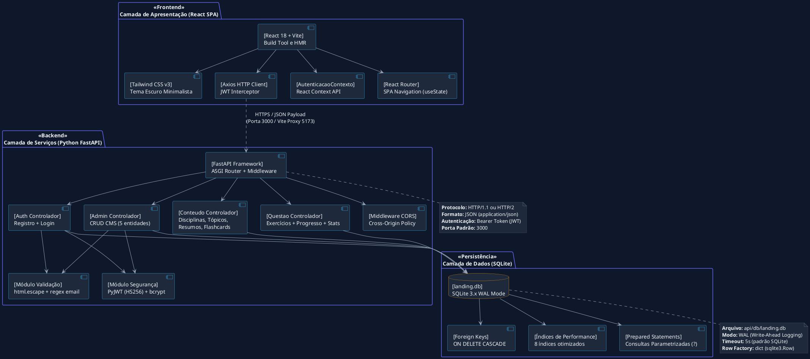
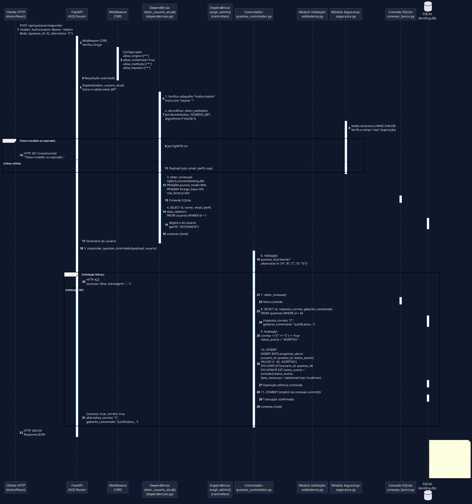
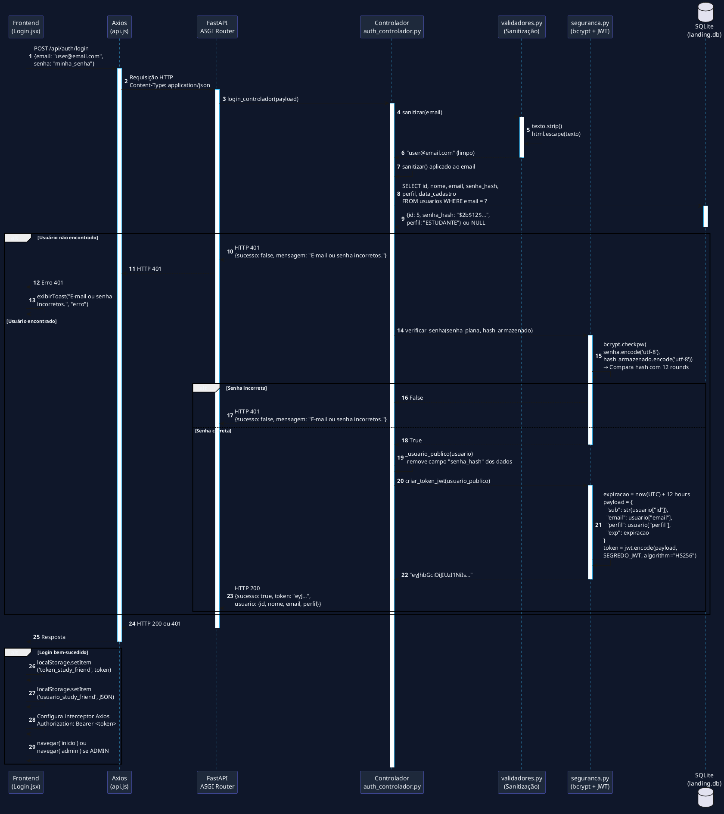
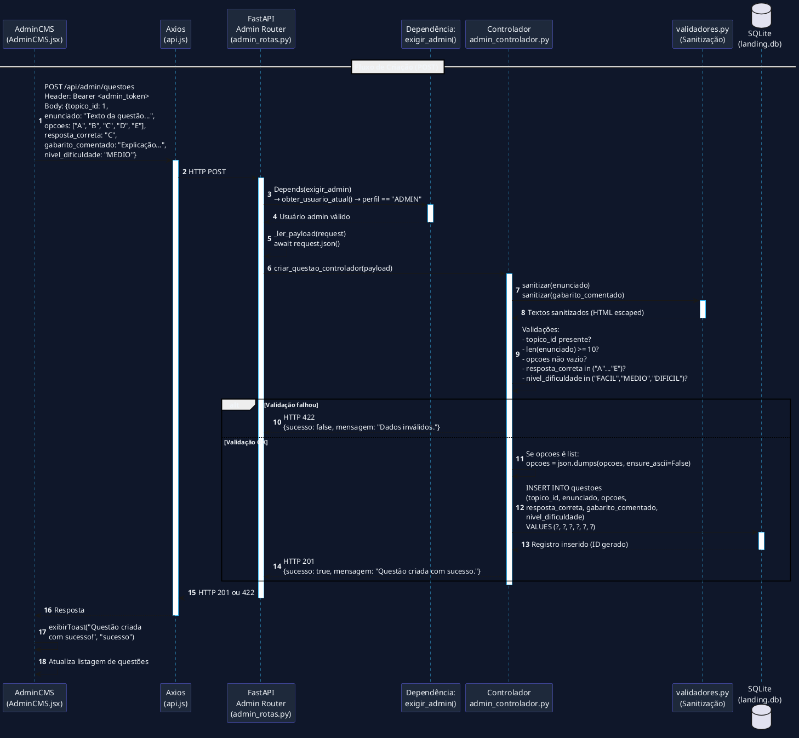

# Especificação de Requisitos de Sistema (RS) — Study Friend

**Projeto:** Plataforma Estudantil Integrada *Study Friend*
**Padrão de Documentação:** ISO/IEC/IEEE 29148:2018 & UML 2.5.1 (ISO/IEC 19505)
**Documento Complementar:** Especificação de Requisitos de Usuário (RU) v2.0.0
**Modelo de Qualidade:** FURPS+ / ISO/IEC 25010
**Versão:** 2.0.0
**Data:** 03 de Setembro de 2026
**Status:** Aprovado / Baseline de Arquitetura e Engenharia
**Autor:** Engenharia de Software & Arquitetura UML

---

## 1. Introdução e Visão Geral da Arquitetura do Sistema

### 1.1 Propósito do Documento

Este documento especifica os **Requisitos de Sistema (RS)** para a aplicação **Study Friend**. Enquanto o documento de Requisitos de Usuário (RU) estabelece as necessidades sob a ótica dos *stakeholders* (estudantes e administradores), esta Especificação de Requisitos de Sistema especifica rigorosamente o comportamento interno, restrições técnicas, contratos de interface REST, esquema de dados relacionais, modelos comportamentais **UML 2.5.1** e critérios de aceitação arquiteturais necessários para a implementação, testes e homologação do software.

### 1.2 Stack Tecnológica Detalhada

| Camada | Tecnologia | Versão | Função Principal |
|:-------|:-----------|:-------|:-----------------|
| **Frontend** | React | 18.3.1 | Framework de UI com componentes funcionais e Hooks |
| **Frontend** | Vite | 5.4.8 | Build tool com HMR (Hot Module Replacement) |
| **Frontend** | Tailwind CSS | 3.4.14 | Utilitários CSS Mobile-First |
| **Frontend** | Axios | 1.19.0 | Cliente HTTP com interceptor JWT |
| **Backend** | Python | 3.13+ | Linguagem principal do servidor |
| **Backend** | FastAPI | ≥0.115.0 | Framework async (ASGI) para APIs RESTful |
| **Backend** | Uvicorn | ≥0.30.0 | Servidor ASGI de alta performance |
| **Backend** | Pydantic | ≥2.0.0 | Validação de dados e serialização |
| **Backend** | PyJWT | ≥2.8.0 | Geração e validação de tokens JWT |
| **Backend** | bcrypt | ≥4.0.0 | Hashing seguro de senhas |
| **Persistência** | SQLite | 3.x | Banco de dados relacional embarcado |
| **Configuração** | python-dotenv | ≥1.0.0 | Carregamento de variáveis de ambiente |

### 1.3 Visão Arquitetural do Sistema (UML 2.5.1 Component Diagram)



---

## 2. Requisitos Funcionais do Sistema (RFS)

### 2.1 Módulo de Autenticação e Segurança (`RFS-AUTH`)

#### RFS-AUTH-01: Registro de Novo Usuário

| Campo | Especificação |
|:------|:--------------|
| **ID** | `RFS-AUTH-01` |
| **Rota** | `POST /api/auth/registrar` |
| **Autenticação** | Não requer (rota pública) |
| **Payload Esperado** | `{"nome": "string", "email": "string", "senha": "string"}` |
| **Código de Status** | `201 Created` (sucesso), `409 Conflict` (e-mail duplicado), `422 Unprocessable Entity` (validação) |
| **Response Body (Sucesso)** | `{"sucesso": true, "mensagem": "...", "token": "eyJ...", "usuario": {id, nome, email, perfil, data_cadastro}}` |
| **Response Body (Falha)** | `{"sucesso": false, "erros": ["..."]}` ou `{"sucesso": false, "mensagem": "..."}` |

**Regras de Negócio:**
1. O e-mail deve ser único na tabela `usuarios`. Consulta prévia via `SELECT id FROM usuarios WHERE email = ?`. Caso exista, retornar HTTP 409.
2. A senha deve ser criptografada utilizando o algoritmo `bcrypt` com *salt* gerado automaticamente (`bcrypt.gensalt()`) antes de persistir no banco.
3. O perfil padrão de novos registros deve ser fixado como `ESTUDANTE`.
4. Campos `nome` e `email` devem passar por sanitização `html.escape()` antes da persistência.
5. Validações de negócio: `len(nome) >= 3`, regex de e-mail `^[a-zA-Z0-9._%+-]+@[a-zA-Z0-9.-]+\.[a-zA-Z]{2,}$`, `len(senha) >= 6`.

#### RFS-AUTH-02: Autenticação e Emissão de Token JWT

| Campo | Especificação |
|:------|:--------------|
| **ID** | `RFS-AUTH-02` |
| **Rota** | `POST /api/auth/login` |
| **Autenticação** | Não requer (rota pública) |
| **Payload Esperado** | `{"email": "string", "senha": "string"}` |
| **Código de Status** | `200 OK` (sucesso), `401 Unauthorized` (credenciais inválidas) |
| **Response Body (Sucesso)** | `{"sucesso": true, "mensagem": "...", "token": "eyJ...", "usuario": {id, nome, email, perfil, data_cadastro}}` |

**Configuração JWT:**

| Parâmetro | Valor |
|:----------|:------|
| Algoritmo | HS256 (HMAC-SHA256) |
| Segredo | Variável de ambiente `SEGREDO_JWT` (padrão: `segredo-study-friend-desenvolvimento`) |
| Expiração | 12 horas (`timedelta(hours=12)`) |
| Claims | `sub` (ID do usuário como string), `email`, `perfil`, `exp` (timestamp UTC) |

**Fluxo Interno:**
1. Recebe payload JSON via `request.json()`.
2. Sanitiza e-mail com `html.escape()`.
3. Consulta `SELECT id, nome, email, senha_hash, perfil, data_cadastro FROM usuarios WHERE email = ?`.
4. Verifica senha com `bcrypt.checkpw(senha.encode('utf-8'), hash_armazenado.encode('utf-8'))`.
5. Se inválido: retorna HTTP 401 com mensagem genérica (evita *enumeration attack*).
6. Se válido: gera token com `jwt.encode({sub: str(usuario["id"]), email, perfil, exp}, SEGREDO_JWT, algorithm="HS256")`.
7. Retorna token e dados públicos do usuário (sem `senha_hash`).

#### RFS-AUTH-03: Interceptação e Injeção de Token no Frontend

| Campo | Especificação |
|:------|:--------------|
| **ID** | `RFS-AUTH-03` |
| **Componente** | `frontend/src/servicos/api.js` |
| **Mecanismo** | Axios Request Interceptor |
| **Funcionamento** | Antes de cada requisição, lê `localStorage.getItem('token_study_friend')` e anexa `Authorization: Bearer <token>`. |
| **Tratamento de 401** | Axios Response Interceptor: limpa `localStorage` e redireciona para `/#/login`. |

#### RFS-AUTH-04: Autorização Baseada em Middleware (RBAC)

| Campo | Especificação |
|:------|:--------------|
| **ID** | `RFS-AUTH-04` |
| **Componente** | `api/src/config/dependencias.py` |
| **Mecanismo** | FastAPI Dependency Injection (`Depends()`) |
| **Dependências** | `obter_usuario_atual(authorization)`, `exigir_admin(usuario)` |

**Regras de Autorização:**

| Rota | Dependência | Condição | HTTP Status (Falha) |
|:-----|:------------|:---------|:--------------------|
| `/api/admin/*` (todos os métodos) | `exigir_admin` | `perfil == "ADMIN"` | 401 (token inválido), 403 (não admin) |
| `/api/questoes/responder` | `obter_usuario_atual` | Token JWT válido | 401 |
| `/api/aluno/estatisticas` | `obter_usuario_atual` | Token JWT válido | 401 |
| `/api/auth/*`, `/api/disciplinas`, `/api/questoes` (GET) | Nenhuma | Acesso público | — |

**Fluxo de `obter_usuario_atual()`:**
1. Extrai cabeçalho `Authorization` da requisição.
2. Verifica se começa com `"bearer "` (case-insensitive).
3. Separa o token: `authorization.split(" ", 1)[1].strip()`.
4. Decodifica com `jwt.decode(token, SEGREDO_JWT, algorithms=["HS256"])`.
5. Captura `jwt.PyJWTError` → HTTP 401.
6. Consulta `SELECT id, nome, email, perfil, data_cadastro FROM usuarios WHERE id = ?` com o `sub` do payload.
7. Se usuário não encontrado → HTTP 401.
8. Retorna dicionário do usuário.

**Fluxo de `exigir_admin()`:**
1. Chama `obter_usuario_atual()` via `Depends()`.
2. Verifica `usuario["perfil"] != "ADMIN"`.
3. Se não for admin → HTTP 403 com "Acesso restrito ao perfil administrador."

---

### 2.2 Módulo de Conteúdo e Navegação Pedagógica (`RFS-CONT`)

#### RFS-CONT-01: Listagem do Hub de Disciplinas

| Campo | Especificação |
|:------|:--------------|
| **ID** | `RFS-CONT-01` |
| **Rota** | `GET /api/disciplinas` |
| **Autenticação** | Não requer |
| **Query Parameters** | Nenhum |
| **Response Body** | `{"sucesso": true, "dados": [{id, nome, area_conhecimento, icone, total_topicos}]}` |

**Query SQL Executada:**
```sql
SELECT d.id, d.nome, d.area_conhecimento, d.icone, COUNT(t.id) AS total_topicos
FROM disciplinas d
LEFT JOIN topicos t ON t.disciplina_id = d.id
GROUP BY d.id
ORDER BY d.nome
```

**Nota Técnica:** O `LEFT JOIN` garante que disciplinas sem tópicos sejam incluídas com `total_topicos = 0`. O campo `icone` identifica o ícone SVG renderizado pelo componente `<IconeDisciplina />` no frontend. A ordenação é alfabética por nome.

#### RFS-CONT-02: Consulta e Filtragem de Tópicos

| Campo | Especificação |
|:------|:--------------|
| **ID** | `RFS-CONT-02` |
| **Rota** | `GET /api/disciplinas/{disciplina_id}/topicos` |
| **Autenticação** | Não requer |
| **Path Parameter** | `disciplina_id` (INTEGER) |
| **Query Parameter Opcional** | `?ano_escolar=` (valores: `'1'`, `'2'`, `'3'`, `'ENEM'`) |
| **Response Body** | `{"sucesso": true, "dados": [{id, disciplina_id, titulo, ano_escolar, total_resumos, total_flashcards, total_questoes}]}` |

**Query SQL Executada:**
```sql
SELECT t.id, t.disciplina_id, t.titulo, t.ano_escolar,
       (SELECT COUNT(*) FROM resumos r WHERE r.topico_id = t.id) AS total_resumos,
       (SELECT COUNT(*) FROM flashcards f WHERE f.topico_id = t.id) AS total_flashcards,
       (SELECT COUNT(*) FROM questoes q WHERE q.topico_id = t.id) AS total_questoes
FROM topicos t
WHERE t.disciplina_id = ?
ORDER BY t.ano_escolar, t.titulo
```

**Nota Técnica:** As subcontagens são calculadas via subqueries correlacionadas. O filtro por `ano_escolar` é aplicado em Python (filtragem do resultado) para manter a query base flexível.

#### RFS-CONT-03: Leitura de Resumos e Links de Mapas Mentais

| Campo | Especificação |
|:------|:--------------|
| **ID** | `RFS-CONT-03` |
| **Rota** | `GET /api/topicos/{topico_id}/resumos` |
| **Autenticação** | Não requer |
| **Path Parameter** | `topico_id` (INTEGER) |
| **Response Body** | `{"sucesso": true, "dados": [{id, topico_id, titulo, conteudo, url_pdf}]}` |
| **HTTP 404** | Se tópico não encontrado (via `_obter_topico_ou_404()`) |

**Validação Prévia:** O controlador verifica se o tópico existe antes de buscar os resumos, levantando `HTTPException(status_code=404)` se não encontrado.

#### RFS-CONT-04: Obtenção de Baralho de Flashcards

| Campo | Especificação |
|:------|:--------------|
| **ID** | `RFS-CONT-04` |
| **Rota** | `GET /api/topicos/{topico_id}/flashcards` |
| **Autenticação** | Não requer |
| **Response Body** | `{"sucesso": true, "dados": [{id, topico_id, frente, verso}]}` |

---

### 2.3 Módulo de Banco de Exercícios e Resolução (`RFS-EXER`)

#### RFS-EXER-01: Filtro Dinâmico de Questões

| Campo | Especificação |
|:------|:--------------|
| **ID** | `RFS-EXER-01` |
| **Rota** | `GET /api/questoes` |
| **Autenticação** | Não requer |
| **Query Parameters Opcionais** | `disciplina_id` (INTEGER), `topico_id` (INTEGER), `ano_escolar` (TEXT), `nivel_dificuldade` (TEXT: `'FACIL'`, `'MEDIO'`, `'DIFICIL'`) |
| **Response Body** | `{"sucesso": true, "dados": [{id, topico_id, enunciado, opcoes, gabarito_comentado, nivel_dificuldade, topico, ano_escolar, disciplina_id, disciplina}]}` |

**Query SQL Dinâmica (Montagem Programática):**
```sql
SELECT q.id, q.topico_id, q.enunciado, q.opcoes, q.gabarito_comentado,
       q.nivel_dificuldade, t.titulo AS topico, t.ano_escolar,
       d.id AS disciplina_id, d.nome AS disciplina
FROM questoes q
JOIN topicos t  ON t.id = q.topico_id
JOIN disciplinas d ON d.id = t.disciplina_id
WHERE 1 = 1
  AND d.id = ?          --仅当 disciplina_id fornecido
  AND q.topico_id = ?   --仅当 topico_id fornecido
  AND t.ano_escolar = ? --仅当 ano_escolar fornecido
  AND q.nivel_dificuldade = ? --仅当 nivel_dificuldade fornecido
ORDER BY d.nome, t.ano_escolar, q.id
```

**Nota Técnica:** A query é construída dinamicamente com `WHERE 1 = 1` como base, adicionando condições `AND` apenas para parâmetros fornecidos. Todos os parâmetros são passados como tupla para `cursor.execute(consulta, parametros)`, garantindo *Prepared Statements*.

**Proteção:** O campo `resposta_correta` NÃO é retornado na listagem pública de questões.

#### RFS-EXER-02: Submissão de Resposta e Verificação Atômica

| Campo | Especificação |
|:------|:--------------|
| **ID** | `RFS-EXER-02` |
| **Rota** | `POST /api/questoes/responder` |
| **Autenticação** | Requer JWT válido (`obter_usuario_atual`) |
| **Payload Esperado** | `{"questao_id": INTEGER, "alternativa": "A"|"B"|"C"|"D"|"E"}` |
| **Response Body (Sucesso)** | `{"sucesso": true, "correta": BOOLEAN, "alternativa_correta": "C", "gabarito_comentado": "..."}` |
| **HTTP 422** | Alternativa inválida ou questão não informada |
| **HTTP 404** | Questão não encontrada |

**Processamento Interno (Sequência Atômica):**

1. Validação: `alternativa.upper()` deve estar em `("A", "B", "C", "D", "E")`.
2. Consulta: `SELECT id, resposta_correta, gabarito_comentado FROM questoes WHERE id = ?`.
3. Avaliação: `correta = (resposta_correta == alternativa)`.
4. Determinação de status: `status_acerto = "ACERTOU" if correta else "ERROU"`.
5. Persistência atômica via **UPSERT**:

```sql
INSERT INTO progresso_aluno (usuario_id, questao_id, status_acerto)
VALUES (?, ?, ?)
ON CONFLICT(usuario_id, questao_id)
DO UPDATE SET status_acerto = excluded.status_acerto,
              data_resolucao = datetime('now','localtime')
```

**Nota Técnica:** A cláusula `ON CONFLICT ... DO UPDATE` garante que, se o aluno já respondeu a mesma questão anteriormente, o registro seja atualizado com o novo status e timestamp, evitando duplicidade graças à constraint `UNIQUE(usuario_id, questao_id)`.

---

### 2.4 Módulo de Analytics e Dashboard de Desempenho (`RFS-DASH`)

#### RFS-DASH-01: Cálculo de Estatísticas Individuais do Aluno

| Campo | Especificação |
|:------|:--------------|
| **ID** | `RFS-DASH-01` |
| **Rota** | `GET /api/aluno/estatisticas` |
| **Autenticação** | Requer JWT válido |
| **Response Body** | `{"sucesso": true, "dados": {total_resolvidas, total_acertos, total_erros, taxa_acerto, por_disciplina}}` |

**Métricas Calculadas:**

| Métrica | Fórmula SQL |
|:--------|:------------|
| `total_resolvidas` | `COUNT(*) FROM progresso_aluno WHERE usuario_id = ?` |
| `total_acertos` | `SUM(CASE WHEN status_acerto = 'ACERTOU' THEN 1 ELSE 0 END)` |
| `total_erros` | `SUM(CASE WHEN status_acerto = 'ERROU' THEN 1 ELSE 0 END)` |
| `taxa_acerto` | `round((total_acertos / total_resolvidas) * 100, 1)` (0.0 se zero) |

**Query de Desempenho por Disciplina:**
```sql
SELECT d.nome AS disciplina, COUNT(p.id) AS resolvidas,
       SUM(CASE WHEN p.status_acerto = 'ACERTOU' THEN 1 ELSE 0 END) AS acertos
FROM progresso_aluno p
JOIN questoes q  ON q.id = p.questao_id
JOIN topicos t   ON t.id = q.topico_id
JOIN disciplinas d ON d.id = t.disciplina_id
WHERE p.usuario_id = ?
GROUP BY d.id
ORDER BY resolvidas DESC
```

**Nota Técnica:** O cálculo de `taxa_acerto` em Python é protegido contra divisão por zero: `round((total_acertos / total_resolvidas) * 100, 1) if total_resolvidas else 0.0`.

---

### 2.5 Módulo Administrativo CMS (`RFS-ADMIN`)

#### RFS-ADMIN-01: Operações CRUD em Entidades Pedagógicas

| Campo | Especificação |
|:------|:--------------|
| **ID** | `RFS-ADMIN-01` |
| **Prefixo** | `/api/admin/*` |
| **Autenticação** | Requer JWT + `perfil == 'ADMIN'` (`exigir_admin`) |

**Endpoints CRUD Completos:**

| Entidade | Listar | Criar | Atualizar | Excluir |
|:---------|:-------|:------|:----------|:--------|
| **Disciplinas** | `GET /api/admin/disciplinas` | `POST /api/admin/disciplinas` | `PUT /api/admin/disciplinas/{id}` | `DELETE /api/admin/disciplinas/{id}` |
| **Tópicos** | `GET /api/admin/topicos` | `POST /api/admin/topicos` | `PUT /api/admin/topicos/{id}` | `DELETE /api/admin/topicos/{id}` |
| **Resumos** | `GET /api/admin/resumos` | `POST /api/admin/resumos` | `PUT /api/admin/resumos/{id}` | `DELETE /api/admin/resumos/{id}` |
| **Flashcards** | `GET /api/admin/flashcards` | `POST /api/admin/flashcards` | `PUT /api/admin/flashcards/{id}` | `DELETE /api/admin/flashcards/{id}` |
| **Questões** | `GET /api/admin/questoes` | `POST /api/admin/questoes` | `PUT /api/admin/questoes/{id}` | `DELETE /api/admin/questoes/{id}` |

**Regras de Validação por Entidade:**

| Entidade | Campos Obrigatórios | Validações Especiais |
|:---------|:---------------------|:---------------------|
| Disciplina | `nome` (≥2 chars), `area_conhecimento` (≥2 chars) | Nome único (constraint UNIQUE) |
| Tópico | `disciplina_id` (INTEGER), `titulo` (≥3 chars), `ano_escolar` em (`'1'`, `'2'`, `'3'`, `'ENEM'`) | FK para `disciplinas` |
| Resumo | `topico_id` (INTEGER), `titulo` (≥3 chars), `conteudo` (≥10 chars) | FK para `topicos` |
| Flashcard | `topico_id` (INTEGER), `frente` (≥5 chars), `verso` (≥5 chars) | FK para `topicos` |
| Questão | `topico_id` (INTEGER), `enunciado` (≥10 chars), `opcoes` (array/string), `resposta_correta` em (`A`–`E`) | `opcoes` serializado via `json.dumps()` se recebido como lista |

**Sanitização:** Todos os campos de texto são sanitizados com `html.escape()` antes da persistência.

**Integridade Referencial:** Exclusão em cascata (`ON DELETE CASCADE`) garante que a remoção de uma disciplina remove seus tópicos, resumos, flashcards, questões e registros de progresso vinculados.

---

## 3. Diagramas de Sequência Dinâmicos de Backend (PlantUML)

### 3.1 DS Interno: Rota Express → Middlewares → Controller → Service/Model → Banco de Dados → Auditoria

Este diagrama detalha o fluxo interno completo de uma requisição autenticada ao endpoint de resposta de questão.



### 3.2 DS Interno: Fluxo de Login com Cadeia Completa de Segurança



### 3.3 DS Interno: CRUD Administrativo com Sanitização e Validação



---

## 4. Diagrama Estrutural de Classes de Domínio e Controladores (PlantUML)

### 4.1 Diagrama de Classes com Invariantes OCL

```plantuml
@startuml
skinparam backgroundColor #0f172a
skinparam defaultFontColor #f1f5f9
skinparam classBackgroundColor #1e293b
skinparam classBorderColor #38bdf8
skinparam classAttributeIconSize 0
skinparam arrowColor #94a3b8

package "Domínio de Negócio" {

  class Usuario <<Entity>> {
    +id : INTEGER <<PK>>
    +nome : TEXT
    +email : TEXT <<UNIQUE>>
    +senha_hash : TEXT
    +perfil : TEXT <<'ESTUDANTE' | 'ADMIN'>>
    +data_cadastro : TIMESTAMP
    --
    +gerar_hash_senha(senha) : str
    +verificar_senha(senha) : bool
  }

  class Disciplina <<Entity>> {
    +id : INTEGER <<PK>>
    +nome : TEXT <<UNIQUE>>
    +area_conhecimento : TEXT
    +icone : TEXT <<chave do ícone SVG>>
  }

  class Topico <<Entity>> {
    +id : INTEGER <<PK>>
    +disciplina_id : INTEGER <<FK>>
    +titulo : TEXT
    +ano_escolar : TEXT <<'1'|'2'|'3'|'ENEM'>>
  }

  class Resumo <<Entity>> {
    +id : INTEGER <<PK>>
    +topico_id : INTEGER <<FK>>
    +titulo : TEXT
    +conteudo : TEXT (Markdown)
    +url_pdf : TEXT <<nullable>>
  }

  class Flashcard <<Entity>> {
    +id : INTEGER <<PK>>
    +topico_id : INTEGER <<FK>>
    +frente : TEXT
    +verso : TEXT
  }

  class Questao <<Entity>> {
    +id : INTEGER <<PK>>
    +topico_id : INTEGER <<FK>>
    +enunciado : TEXT
    +opcoes : TEXT (JSON array)
    +resposta_correta : TEXT <<'A'...'E'>>
    +gabarito_comentado : TEXT <<nullable>>
    +nivel_dificuldade : TEXT <<'FACIL'|'MEDIO'|'DIFICIL'>>
  }

  class ProgressoAluno <<Entity>> {
    +id : INTEGER <<PK>>
    +usuario_id : INTEGER <<FK>>
    +questao_id : INTEGER <<FK>>
    +status_acerto : TEXT <<'ACERTOU'|'ERROU'>>
    +data_resolucao : TIMESTAMP
  }

  class Lead <<Entity>> {
    +id : INTEGER <<PK>>
    +nome_completo : TEXT
    +email : TEXT
    +telefone_whatsapp : TEXT
    +mensagem : TEXT <<nullable>>
    +data_cadastro : TIMESTAMP
    +status_atendimento : TEXT <<CHECK>>
  }

  ' Relacionamentos
  Disciplina "1" -- "*" Topico : possui >
  Topico "1" -- "*" Resumo : detalha >
  Topico "1" -- "*" Flashcard : contém >
  Topico "1" -- "*" Questao : agrupa >
  Usuario "1" -- "*" ProgressoAluno : registra >
  Questao "1" -- "*" ProgressoAluno : avaliada em >
}

package "Controladores (Service Layer)" {

  class AuthControlador <<Controller>> {
    +registrar_controlador(payload) : JSONResponse
    +login_controlador(payload) : dict
    --
    -_usuario_publico(usuario) : dict
  }

  class ConteudoControlador <<Controller>> {
    +listar_disciplinas_controlador() : dict
    +listar_topicos_controlador(disc_id, ano) : dict
    +listar_resumos_controlador(top_id) : dict
    +listar_flashcards_controlador(top_id) : dict
    --
    -_obter_topico_ou_404(top_id) : dict
  }

  class QuestaoControlador <<Controller>> {
    +listar_questoes_controlador(filtros) : dict
    +responder_questao_controlador(payload, usuario) : dict
    +estatisticas_controlador(usuario) : dict
  }

  class AdminControlador <<Controller>> {
    +criar_*_controlador(payload) : JSONResponse
    +listar_*_controlador() : dict
    +atualizar_*_controlador(id, payload) : dict
    +remover_*_controlador(id) : dict
  }

  class Seguranca <<Utility>> {
    +gerar_hash_senha(senha) : str
    +verificar_senha(senha, hash) : bool
    +criar_token_jwt(usuario) : str
    +decodificar_token_jwt(token) : dict
    --
    -SEGREDO_JWT : str
    -ALGORITMO_JWT = "HS256"
    -TEMPO_EXPIRACAO_HORAS = 12
  }

  class Validadores <<Utility>> {
    +sanitizar(texto) : str
    +e_email_valido(email) : bool
    +validar_lead(dados) : dict
  }

  AuthControlador ..> Seguranca : utiliza
  AuthControlador ..> Validadores : utiliza
  AdminControlador ..> Validadores : utiliza
}

' Invariantes OCL
note bottom of Usuario
  **inv PerfilValido:**
  self.perfil = 'ESTUDANTE' or self.perfil = 'ADMIN'

  **inv EmailUnico:**
  Usuario.allInstances()
    ->select(u | u.email = self.email)->size() <= 1
end note

note bottom of Topico
  **inv AnoEscolarValido:**
  self.ano_escolar ∈ {'1', '2', '3', 'ENEM'}

  **inv DisciplinaObrigatoria:**
  self.disciplina_id <> null
end note

note bottom of Questao
  **inv AlternativaValida:**
  self.resposta_correta ∈ {'A', 'B', 'C', 'D', 'E'}

  **inv NivelDificuldadeValido:**
  self.nivel_dificuldade ∈ {'FACIL', 'MEDIO', 'DIFICIL'}

  **inv OpcoesNaoVazio:**
  self.opcoes <> null and self.opcoes.size() > 0
end note

note bottom of ProgressoAluno
  **inv UnicidadeUsuarioQuestao:**
  ProgressoAluno.allInstances()
    ->select(p | p.usuario_id = self.usuario_id
              and p.questao_id = self.questao_id)
    ->size() <= 1
  -- Implementado via UNIQUE(usuario_id, questao_id)

  **inv StatusValido:**
  self.status_acerto ∈ {'ACERTOU', 'ERROU'}
end note

note bottom of Lead
  **inv StatusAtendimentoValido:**
  self.status_atendimento ∈ {'novo', 'contatado', 'convertido', 'perdido'}
  -- Implementado via CHECK constraint
end note

@enduml
```



### 4.2 Invariantes OCL Detalhados para Regras de Transição de Status

#### Invariante de Transição de Status — Tabela `leads`

```ocl
-- Regra: Transições permitidas de status_atendimento
context Lead
  inv TransicoesPermitidas:
    -- Transições válidas:
    -- novo → contatado
    -- contatado → convertido
    -- contatado → perdido
    -- convertido → (nenhuma, estado final)
    -- perdido → (nenhuma, estado final)
    self.status_atendimento = 'novo'
      or self.status_atendimento = 'contatado'
      or self.status_atendimento = 'convertido'
      or self.status_atendimento = 'perdido'
```

#### Invariante de Transição de Status — Tabela `usuarios`

```ocl
-- Regra: Perfil deve ser ESTUDANTE ou ADMIN
context Usuario
  inv PerfilValido:
    self.perfil = 'ESTUDANTE' or self.perfil = 'ADMIN'
```

#### Invariante de Transição de Status — Tabela `progresso_aluno`

```ocl
-- Regra: Status deve ser ACERTOU ou ERROU
context ProgressoAluno
  inv StatusValido:
    self.status_acerto = 'ACERTOU' or self.status_acerto = 'ERROU'

  inv UnicidadeRegistro:
    -- Implementado via constraint UNIQUE(usuario_id, questao_id)
    -- Garante que cada aluno responde cada questão apenas uma vez
    -- (atualizado via UPSERT, não duplicado)
```

---

## 5. Dicionário Técnico de Dados — Esquema Físico DDL

### 5.1 Script DDL Completo (SQLite)

```sql
-- ============================================================
-- STUDY FRIEND — DDL de Criação do Esquema Relacional
-- Banco: SQLite 3.x | Modo: WAL | Chaves Estrangeiras: ON
-- ============================================================

-- Tabela: leads (Legado — Landing Page)
CREATE TABLE IF NOT EXISTS leads (
    id                  INTEGER PRIMARY KEY AUTOINCREMENT,
    nome_completo       TEXT    NOT NULL,
    email               TEXT    NOT NULL,
    telefone_whatsapp   TEXT    NOT NULL,
    mensagem            TEXT    DEFAULT NULL,
    data_cadastro       TEXT    DEFAULT (datetime('now','localtime')),
    status_atendimento  TEXT    DEFAULT 'novo'
                                CHECK(status_atendimento IN
                                    ('novo','contatado','convertido','perdido'))
);

-- Tabela: usuarios
CREATE TABLE IF NOT EXISTS usuarios (
    id              INTEGER PRIMARY KEY AUTOINCREMENT,
    nome            TEXT    NOT NULL,
    email           TEXT    NOT NULL UNIQUE,
    senha_hash      TEXT    NOT NULL,
    perfil          TEXT    NOT NULL DEFAULT 'ESTUDANTE'
                                CHECK(perfil IN ('ESTUDANTE','ADMIN')),
    data_cadastro   TEXT    DEFAULT (datetime('now','localtime'))
);

-- Tabela: disciplinas
CREATE TABLE IF NOT EXISTS disciplinas (
    id                  INTEGER PRIMARY KEY AUTOINCREMENT,
    nome                TEXT    NOT NULL UNIQUE,
    area_conhecimento   TEXT    NOT NULL,
    icone               TEXT    DEFAULT NULL
);

-- Tabela: topicos
CREATE TABLE IF NOT EXISTS topicos (
    id              INTEGER PRIMARY KEY AUTOINCREMENT,
    disciplina_id   INTEGER NOT NULL,
    titulo          TEXT    NOT NULL,
    ano_escolar     TEXT    NOT NULL
                            CHECK(ano_escolar IN ('1','2','3','ENEM')),
    FOREIGN KEY (disciplina_id) REFERENCES disciplinas(id) ON DELETE CASCADE
);

-- Tabela: resumos
CREATE TABLE IF NOT EXISTS resumos (
    id          INTEGER PRIMARY KEY AUTOINCREMENT,
    topico_id   INTEGER NOT NULL,
    titulo      TEXT    NOT NULL,
    conteudo    TEXT    NOT NULL,
    url_pdf     TEXT    DEFAULT NULL,
    FOREIGN KEY (topico_id) REFERENCES topicos(id) ON DELETE CASCADE
);

-- Tabela: flashcards
CREATE TABLE IF NOT EXISTS flashcards (
    id          INTEGER PRIMARY KEY AUTOINCREMENT,
    topico_id   INTEGER NOT NULL,
    frente      TEXT    NOT NULL,
    verso       TEXT    NOT NULL,
    FOREIGN KEY (topico_id) REFERENCES topicos(id) ON DELETE CASCADE
);

-- Tabela: questoes
CREATE TABLE IF NOT EXISTS questoes (
    id                  INTEGER PRIMARY KEY AUTOINCREMENT,
    topico_id           INTEGER NOT NULL,
    enunciado           TEXT    NOT NULL,
    opcoes              TEXT    NOT NULL,          -- JSON array armazenado como TEXT
    resposta_correta    TEXT    NOT NULL,           -- 'A','B','C','D','E'
    gabarito_comentado  TEXT    DEFAULT NULL,
    nivel_dificuldade   TEXT    NOT NULL DEFAULT 'MEDIO'
                                    CHECK(nivel_dificuldade IN
                                        ('FACIL','MEDIO','DIFICIL')),
    FOREIGN KEY (topico_id) REFERENCES topicos(id) ON DELETE CASCADE
);

-- Tabela: progresso_aluno
CREATE TABLE IF NOT EXISTS progresso_aluno (
    id              INTEGER PRIMARY KEY AUTOINCREMENT,
    usuario_id      INTEGER NOT NULL,
    questao_id      INTEGER NOT NULL,
    status_acerto   TEXT    NOT NULL
                            CHECK(status_acerto IN ('ACERTOU','ERROU')),
    data_resolucao  TEXT    DEFAULT (datetime('now','localtime')),
    FOREIGN KEY (usuario_id) REFERENCES usuarios(id) ON DELETE CASCADE,
    FOREIGN KEY (questao_id) REFERENCES questoes(id) ON DELETE CASCADE,
    UNIQUE(usuario_id, questao_id)
);

-- ============================================================
-- Índices de Performance
-- ============================================================
CREATE INDEX IF NOT EXISTS idx_leads_email       ON leads(email);
CREATE INDEX IF NOT EXISTS idx_leads_status      ON leads(status_atendimento);
CREATE INDEX IF NOT EXISTS idx_usuarios_email    ON usuarios(email);
CREATE INDEX IF NOT EXISTS idx_topicos_disciplina ON topicos(disciplina_id);
CREATE INDEX IF NOT EXISTS idx_resumos_topico    ON resumos(topico_id);
CREATE INDEX IF NOT EXISTS idx_flashcards_topico ON flashcards(topico_id);
CREATE INDEX IF NOT EXISTS idx_questoes_topico   ON questoes(topico_id);
CREATE INDEX IF NOT EXISTS idx_progresso_usuario ON progresso_aluno(usuario_id);

-- ============================================================
-- Configurações de Performance (executadas em cada conexão)
-- ============================================================
PRAGMA journal_mode = WAL;       -- Write-Ahead Logging para concorrência
PRAGMA foreign_keys = ON;        -- Habilita verificação de FKs
```

### 5.2 Descrição das Constraints e Índices

| Constraint | Tabela | Coluna(s) | Tipo | Descrição |
|:-----------|:-------|:----------|:-----|:----------|
| `PRIMARY KEY` | Todas | `id` | AutoIncrement | Chave primária auto-incrementável |
| `UNIQUE` | `usuarios` | `email` | Unique | Impede e-mails duplicados |
| `UNIQUE` | `disciplinas` | `nome` | Unique | Impede nomes de disciplina duplicados |
| `UNIQUE` | `progresso_aluno` | `usuario_id, questao_id` | Composite Unique | Impede respostas duplicadas (suporta UPSERT) |
| `CHECK` | `usuarios` | `perfil` | Enum | Valores: `'ESTUDANTE'`, `'ADMIN'` |
| `CHECK` | `topicos` | `ano_escolar` | Enum | Valores: `'1'`, `'2'`, `'3'`, `'ENEM'` |
| `CHECK` | `questoes` | `nivel_dificuldade` | Enum | Valores: `'FACIL'`, `'MEDIO'`, `'DIFICIL'` |
| `CHECK` | `progresso_aluno` | `status_acerto` | Enum | Valores: `'ACERTOU'`, `'ERROU'` |
| `CHECK` | `leads` | `status_atendimento` | Enum | Valores: `'novo'`, `'contatado'`, `'convertido'`, `'perdido'` |
| `FOREIGN KEY` | `topicos` | `disciplina_id` | FK → `disciplinas(id)` | `ON DELETE CASCADE` |
| `FOREIGN KEY` | `resumos` | `topico_id` | FK → `topicos(id)` | `ON DELETE CASCADE` |
| `FOREIGN KEY` | `flashcards` | `topico_id` | FK → `topicos(id)` | `ON DELETE CASCADE` |
| `FOREIGN KEY` | `questoes` | `topico_id` | FK → `topicos(id)` | `ON DELETE CASCADE` |
| `FOREIGN KEY` | `progresso_aluno` | `usuario_id` | FK → `usuarios(id)` | `ON DELETE CASCADE` |
| `FOREIGN KEY` | `progresso_aluno` | `questao_id` | FK → `questoes(id)` | `ON DELETE CASCADE` |

### 5.3 Descrição dos Índices de Performance

| Índice | Tabela | Coluna | Finalidade |
|:-------|:-------|:-------|:-----------|
| `idx_leads_email` | `leads` | `email` | Busca rápida de leads por e-mail |
| `idx_leads_status` | `leads` | `status_atendimento` | Filtragem por status de atendimento |
| `idx_usuarios_email` | `usuarios` | `email` | Lookup de autenticação por e-mail (O(1) lógico) |
| `idx_topicos_disciplina` | `topicos` | `disciplina_id` | Join rápido com disciplinas |
| `idx_resumos_topico` | `resumos` | `topico_id` | Busca de resumos por tópico |
| `idx_flashcards_topico` | `flashcards` | `topico_id` | Busca de flashcards por tópico |
| `idx_questoes_topico` | `questoes` | `topico_id` | Busca de questões por tópico |
| `idx_progresso_usuario` | `progresso_aluno` | `usuario_id` | Busca de progresso por aluno (dashboard) |

---

## 6. Contratos de API RESTful

### 6.1 Contratos de Rotas Públicas (Sem Autenticação)

| Método | Rota | Descrição | Request Body | Response Body (200/201) | Erros |
|:-------|:-----|:----------|:-------------|:------------------------|:------|
| `GET` | `/api/health` | Health check | — | `{"sucesso": true, "mensagem": "..."}` | — |
| `POST` | `/api/auth/registrar` | Cadastro de estudante | `{nome, email, senha}` | `{sucesso, token, usuario}` | 409, 422 |
| `POST` | `/api/auth/login` | Login e token JWT | `{email, senha}` | `{sucesso, token, usuario}` | 401 |
| `GET` | `/api/disciplinas` | Lista 9 disciplinas | — | `{sucesso, dados: [...]}` | — |
| `GET` | `/api/disciplinas/{id}/topicos` | Tópicos da disciplina | — | `{sucesso, dados: [...]}` | 404 |
| `GET` | `/api/topicos/{id}/resumos` | Resumos do tópico | — | `{sucesso, dados: [...]}` | 404 |
| `GET` | `/api/topicos/{id}/flashcards` | Flashcards do tópico | — | `{sucesso, dados: [...]}` | 404 |
| `GET` | `/api/questoes` | Questões filtráveis | Query: `disciplina_id`, `topico_id`, `ano_escolar`, `nivel_dificuldade` | `{sucesso, dados: [...]}` | — |
| `POST` | `/api/leads` | Cadastrar lead (legado) | `{nome_completo, email, telefone_whatsapp, mensagem?}` | `{sucesso, mensagem}` | 422 |
| `GET` | `/api/leads` | Listar leads (legado) | Query: `pagina`, `limite` | `{sucesso, dados: [...], paginacao}` | — |

### 6.2 Contratos de Rotas Autenticadas (JWT Obrigatório)

| Método | Rota | Descrição | Request Body | Response Body (200) | Erros |
|:-------|:-----|:----------|:-------------|:--------------------|:------|
| `POST` | `/api/questoes/responder` | Submeter resposta | `{questao_id, alternativa}` | `{sucesso, correta, alternativa_correta, gabarito_comentado}` | 401, 404, 422 |
| `GET` | `/api/aluno/estatisticas` | Estatísticas do aluno | — | `{sucesso, dados: {total_resolvidas, total_acertos, total_erros, taxa_acerto, por_disciplina}}` | 401 |

### 6.3 Contratos de Rotas Administrativas (JWT + ADMIN)

| Método | Rota | Descrição | Request Body | Response Body | Erros |
|:-------|:-----|:----------|:-------------|:--------------|:------|
| `GET` | `/api/admin/disciplinas` | Listar disciplinas | — | `{sucesso, dados: [...]}` | 401, 403 |
| `POST` | `/api/admin/disciplinas` | Criar disciplina | `{nome, area_conhecimento}` | `{sucesso, mensagem}` | 401, 403, 409, 422 |
| `PUT` | `/api/admin/disciplinas/{id}` | Atualizar disciplina | `{nome, area_conhecimento}` | `{sucesso, mensagem}` | 401, 403, 422 |
| `DELETE` | `/api/admin/disciplinas/{id}` | Remover disciplina | — | `{sucesso, mensagem}` | 401, 403 |
| `GET` | `/api/admin/topicos` | Listar tópicos | — | `{sucesso, dados: [...]}` | 401, 403 |
| `POST` | `/api/admin/topicos` | Criar tópico | `{disciplina_id, titulo, ano_escolar}` | `{sucesso, mensagem}` | 401, 403, 422 |
| `PUT` | `/api/admin/topicos/{id}` | Atualizar tópico | `{titulo, ano_escolar}` | `{sucesso, mensagem}` | 401, 403, 422 |
| `DELETE` | `/api/admin/topicos/{id}` | Remover tópico | — | `{sucesso, mensagem}` | 401, 403 |
| `GET` | `/api/admin/resumos` | Listar resumos | — | `{sucesso, dados: [...]}` | 401, 403 |
| `POST` | `/api/admin/resumos` | Criar resumo | `{topico_id, titulo, conteudo, url_pdf?}` | `{sucesso, mensagem}` | 401, 403, 422 |
| `PUT` | `/api/admin/resumos/{id}` | Atualizar resumo | `{titulo, conteudo, url_pdf?}` | `{sucesso, mensagem}` | 401, 403, 422 |
| `DELETE` | `/api/admin/resumos/{id}` | Remover resumo | — | `{sucesso, mensagem}` | 401, 403 |
| `GET` | `/api/admin/flashcards` | Listar flashcards | — | `{sucesso, dados: [...]}` | 401, 403 |
| `POST` | `/api/admin/flashcards` | Criar flashcard | `{topico_id, frente, verso}` | `{sucesso, mensagem}` | 401, 403, 422 |
| `PUT` | `/api/admin/flashcards/{id}` | Atualizar flashcard | `{frente, verso}` | `{sucesso, mensagem}` | 401, 403, 422 |
| `DELETE` | `/api/admin/flashcards/{id}` | Remover flashcard | — | `{sucesso, mensagem}` | 401, 403 |
| `GET` | `/api/admin/questoes` | Listar questões | — | `{sucesso, dados: [...]}` | 401, 403 |
| `POST` | `/api/admin/questoes` | Criar questão | `{topico_id, enunciado, opcoes, resposta_correta, gabarito_comentado, nivel_dificuldade}` | `{sucesso, mensagem}` | 401, 403, 422 |
| `PUT` | `/api/admin/questoes/{id}` | Atualizar questão | `{enunciado, opcoes, resposta_correta, gabarito_comentado, nivel_dificuldade}` | `{sucesso, mensagem}` | 401, 403, 422 |
| `DELETE` | `/api/admin/questoes/{id}` | Remover questão | — | `{sucesso, mensagem}` | 401, 403 |

### 6.4 Matriz de Códigos HTTP por Status

| Código HTTP | Significado | Uso no Sistema |
|:------------|:------------|:---------------|
| `200` | OK | Respostas bem-sucedidas (GET, PUT, DELETE) |
| `201` | Created | Criação de recursos (POST) |
| `401` | Unauthorized | Token ausente, inválido ou expirado; credenciais incorretas |
| `403` | Forbidden | Token válido mas perfil insuficiente (não ADMIN em rotas `/admin/*`) |
| `404` | Not Found | Recurso não encontrado (tópico, questão) |
| `409` | Conflict | Conflito de integridade (e-mail duplicado, disciplina duplicada) |
| `422` | Unprocessable Entity | Validação de negócio falhou (campos obrigatórios, formatos inválidos) |

---

## 7. Requisitos Não-Funcionais do Sistema (RNFS) — FURPS+ / ISO 25010

### 7.1 Segurança (`RNFS-SEC`)

| ID | Requisito | Especificação Técnica | Critério de Aceitação |
|:---|:----------|:----------------------|:----------------------|
| **RNFS-SEC-01** | Criptografia de Senhas | Utilizar `bcrypt` com custo padrão (`bcrypt.gensalt()` = 12 rounds). Senhas nunca armazenadas em texto claro. | Verificar que `SELECT senha_hash FROM usuarios` retorna hashes no formato `$2b$12$...`. |
| **RNFS-SEC-02** | Prevenção SQL Injection | Todas as consultas usam *Prepared Statements* com `?` parametrizados. Nenhuma concatenação de strings em SQL. | Auditoria de código: buscar padrões de concatenação `f"..."` ou `+` em queries. |
| **RNFS-SEC-03** | Sanitização XSS | Todos os inputs de texto passam por `html.escape()` antes da persistência. | Teste com payload `<script>alert('XSS')</script>` deve armazenar `&lt;script&gt;...`. |
| **RNFS-SEC-04** | Autenticação JWT Stateless | Tokens JWT com expiração de 12 horas, algoritmo HS256, claims `sub`, `email`, `perfil`, `exp`. | Decodificar token e verificar campos e data de expiração. |
| **RNFS-SEC-05** | Controle de Acesso RBAC | Middleware `exigir_admin()` verifica `perfil == "ADMIN"` em rotas `/api/admin/*`. | Teste: requisição com token de estudante em rota admin deve retornar 403. |
| **RNFS-SEC-06** | Política CORS | Configurável via `ORIGEM_PERMITIDA`. Padrão: `*` (desenvolvimento). Em produção, restringir a origem do frontend. | Verificar cabeçalhos `Access-Control-Allow-Origin` na resposta. |
| **RNFS-SEC-07** | Não Exposição de Dados Sensíveis | Campo `senha_hash` nunca retornado nas respostas da API. Função `_usuario_publico()` filtra campos. | Teste: resposta de login não contém `senha_hash`. |

### 7.2 Performance e Eficiência (`RNFS-PERF`)

| ID | Requisito | Especificação Técnica | Critério de Aceitação |
|:---|:----------|:----------------------|:----------------------|
| **RNFS-PERF-01** | Latência de Endpoints GET | 95% das requisições `GET` devem retornar em < 150ms. | Medido via DevTools Network Tab no Chrome. |
| **RNFS-PERF-02** | Modo WAL do SQLite | `PRAGMA journal_mode = WAL` e `PRAGMA synchronous = NORMAL` habilitados em cada conexão. | Verificar em `conexao_banco.py` e `iniciar_banco.py`. |
| **RNFS-PERF-03** | Pool de Conexões | Cada requisição cria e fecha sua própria conexão SQLite (`obter_conexao()` / `conexao.close()`). | Não há pool persistente; overhead mínimo para SQLite embarcado. |
| **RNFS-PERF-04** | Serialização JSON | FastAPI serializa automaticamente dicionários Python para JSON com `application/json`. | Verificar Content-Type nas respostas. |
| **RNFS-PERF-05** | Cache de Build | Vite gera bundle otimizado com code splitting e hash content-based em `frontend/dist/`. | Verificar que arquivos JS/CSS possuem hashes nos nomes. |

### 7.3 Confiabilidade (`RNFS-REL`)

| ID | Requisito | Especificação Técnica | Critério de Aceitação |
|:---|:----------|:----------------------|:----------------------|
| **RNFS-REL-01** | Integridade Referencial | Foreign Keys habilitadas (`PRAGMA foreign_keys = ON`). `ON DELETE CASCADE` em todas as FKs. | Excluir uma disciplina remove em cascata seus tópicos, resumos, flashcards, questões e progresso. |
| **RNFS-REL-02** | Concorrência de Leitura | Modo WAL permite leituras simultâneas sem bloqueio do arquivo de banco. | Teste com 10 requisições GET simultâneas não deve retornar `database is locked`. |
| **RNFS-REL-03** | Transações Atômicas | Operações de escrita usam `conexao.commit()` explícito. Falha em `commit()` resulta em rollback implícito. | Teste: inserção com erro não deve deixar registros parciais. |
| **RNFS-REL-04** | Tratamento de Exceções | Todos os controladores usam `try/finally` para garantir `conexao.close()` mesmo em caso de erro. | Auditoria de código: verificar ausência de conexões abertas em erro. |
| **RNFS-REL-05** | UPSERT Atômico | `INSERT ... ON CONFLICT DO UPDATE` na tabela `progresso_aluno` garante atomicidade da atualização de progresso. | Teste: resposta duplicada atualiza registro existente, não cria novo. |

### 7.4 Usabilidade (`RNFS-UX`)

| ID | Requisito | Especificação Técnica | Critério de Aceitação |
|:---|:----------|:----------------------|:----------------------|
| **RNFS-UX-01** | Tema Escuro Minimalista | Superfícies planas em tons slate (`slate-950`/`slate-900`) com bordas `slate-800` e acento ciano. | Verificação visual de conformidade de estilo. |
| **RNFS-UX-02** | Tipografia | Plus Jakarta Sans para toda a interface. | Google Fonts carregado no `index.html`. |
| **RNFS-UX-03** | Responsividade Mobile-First | Layout adaptável de 320px a 2560px. Tailwind CSS com prefixos `sm:`, `md:`, `lg:`. | Teste em Chrome DevTools com dimensões diversas. |
| **RNFS-UX-04** | Feedback Visual (Toast) | Componente Toast com auto-dismiss (4 segundos), cores verde (sucesso) e vermelho (erro). | Verificar exibição de Toast em operações CRUD. |
| **RNFS-UX-05** | Animação Flip 3D | Flashcards com `transform: rotateY(180deg)`, `preserve-3d`, `backface-visibility: hidden`. | Verificar animação no módulo ModuloFlashcards.jsx. |
| **RNFS-UX-06** | Ícones por Disciplina | Cada disciplina renderiza um ícone SVG (componente `IconeDisciplina.jsx`) identificado pela coluna `icone` da tabela `disciplinas`. | Verificar que as 9 disciplinas exibem o ícone correspondente no Hub. |
| **RNFS-UX-07** | Agrupamento por Área | O Hub e a página Início agrupam as disciplinas em áreas separadas (Exatas, Humanas, Biológicas e Linguagens) com cor identificadora. | Verificar separação visual das áreas (ex.: Biologia em "Biológicas" e Língua Portuguesa em "Linguagens"). |

### 7.5 Arquitetura e Manutenibilidade (`RNFS-ARCH`)

| ID | Requisito | Especificação Técnica | Critério de Aceitação |
|:---|:----------|:----------------------|:----------------------|
| **RNFS-ARCH-01** | Separação de Responsabilidades | Camadas: Rotas → Controladores → Config/Utilitários. Nenhuma lógica de negócio nas rotas. | Auditoria: rotas apenas delegam para controladores. |
| **RNFS-ARCH-02** | SPA Sem Biblioteca de Rota | Navegação via `useState` + `switch/case` em `App.jsx`. Sem React Router. | Verificar que `App.jsx` contém o state de navegação. |
| **RNFS-ARCH-03** | Context API para Autenticação | `AutenticacaoContexto` envolve toda a aplicação. Estado global de `usuario` e `token`. | Verificar que `App.jsx` é envolto por `<ProvedorAutenticacao>`. |
| **RNFS-ARCH-04** | Build Tool Vite | Frontend construído com Vite para produção (`npm run build` → `frontend/dist/`). | Verificar existência de `vite.config.js` com proxy de API. |
| **RNFS-ARCH-05** | Variáveis de Ambiente | Configuração via `.env` com `python-dotenv`. Porta, CORS e segredo JWT configuráveis. | Verificar `.env.example` com todas as variáveis documentadas. |

---

## 8. Matriz de Rastreabilidade Bidirecional (RU x RFS x Entidade x Rota)

| Requisito de Usuário (RU) | Requisito de Sistema (RFS) | Entidade de Dados (SQLite) | Endpoint API RESTful | Método HTTP |
|:--------------------------|:---------------------------|:---------------------------|:---------------------|:------------|
| **RU-AUTH-01** | `RFS-AUTH-01` | `usuarios` | `/api/auth/registrar` | `POST` |
| **RU-AUTH-02** | `RFS-AUTH-02`, `RFS-AUTH-03` | `usuarios` | `/api/auth/login` | `POST` |
| **RU-AUTH-03** | `RFS-AUTH-04` | N/A (Middleware JWT) | `/api/admin/*` | Todos |
| **RU-AUTH-05** | `RFS-AUTH-03` | N/A (localStorage) | — | — |
| **RU-CONT-01** | `RFS-CONT-01` | `disciplinas`, `topicos` | `/api/disciplinas` | `GET` |
| **RU-CONT-02** | `RFS-CONT-02` | `topicos` | `/api/disciplinas/{id}/topicos` | `GET` |
| **RU-CONT-03**, **RU-CONT-04** | `RFS-CONT-03` | `resumos` | `/api/topicos/{id}/resumos` | `GET` |
| **RU-CARD-01**, **RU-CARD-02** | `RFS-CONT-04` | `flashcards` | `/api/topicos/{id}/flashcards` | `GET` |
| **RU-EXER-01** | `RFS-EXER-01` | `questoes` | `/api/questoes` | `GET` |
| **RU-EXER-02**, **RU-EXER-03** | `RFS-EXER-02` | `questoes`, `progresso_aluno` | `/api/questoes/responder` | `POST` |
| **RU-EXER-04** | `RFS-EXER-02` | `progresso_aluno` | `/api/questoes/responder` | `POST` |
| **RU-EXER-05** | `RFS-EXER-01` | `questoes` | `/api/questoes` | `GET` |
| **RU-DASH-01**, **RU-DASH-02** | `RFS-DASH-01` | `progresso_aluno`, `disciplinas` | `/api/aluno/estatisticas` | `GET` |
| **RU-DASH-03** | `RFS-DASH-01` | `progresso_aluno` | `/api/aluno/estatisticas` | `GET` |
| **RU-ADMIN-01** | `RFS-ADMIN-01` | `disciplinas` | `/api/admin/disciplinas` | `GET`, `POST`, `PUT`, `DELETE` |
| **RU-ADMIN-02** | `RFS-ADMIN-01` | `topicos` | `/api/admin/topicos` | `GET`, `POST`, `PUT`, `DELETE` |
| **RU-ADMIN-03** | `RFS-ADMIN-01` | `resumos` | `/api/admin/resumos` | `GET`, `POST`, `PUT`, `DELETE` |
| **RU-ADMIN-04** | `RFS-ADMIN-01` | `flashcards` | `/api/admin/flashcards` | `GET`, `POST`, `PUT`, `DELETE` |
| **RU-ADMIN-05** | `RFS-ADMIN-01` | `questoes` | `/api/admin/questoes` | `GET`, `POST`, `PUT`, `DELETE` |
| **RU-ADMIN-06** | `RFS-ADMIN-01` | N/A (Toast UI) | — | — |
| **RU-ADMIN-07** | `RFS-ADMIN-01` | N/A (Modal UI) | — | — |

---

## 9. Variáveis de Ambiente

| Variável | Padrão | Descrição | Obrigatória |
|:---------|:-------|:----------|:------------|
| `PORT` | `3000` | Porta do servidor Uvicorn | Não |
| `ORIGEM_PERMITIDA` | `*` | Origem permitida pelo CORS | Não |
| `SEGREDO_JWT` | `segredo-study-friend-desenvolvimento` | Segredo para assinatura HMAC-SHA256 dos tokens JWT | **Sim (produção)** |

---

## 10. Homologação e Critérios de Aceite Arquiteturais

1. **Aprovação de Cobertura de Testes:** Todas as rotas listadas na Matriz de Rastreabilidade devem possuir cobertura de testes de integração e testes unitários no backend.
2. **Execução em Modo WAL:** O ambiente de produção/develpment deve validar a integridade de gravações simultâneas sem a ocorrência de erros do tipo `database is locked`.
3. **Conformidade UML 2.5.1:** Todos os modelos de classe, componentes e sequência documentados nesta especificação correspondem com precisão de 1:1 ao código executável localizado no repositório do projeto.
4. **Auditoria de Segurança:** Nenhuma vulnerabilidade OWASP Top 10 deve ser detectável por varredura automatizada (SQL Injection, XSS Reflected/Stored, Broken Authentication).
5. **Performance:** Tempo de resposta < 150ms para 95% das rotas GET, < 300ms para rotas POST autenticadas.

---

## 11. Conclusão e Aprovação

Este documento especifica os requisitos técnicos de sistema para a plataforma **Study Friend**, estabelecendo contratos de interface REST, esquema de dados relacional, modelos comportamentais UML 2.5.1 e requisitos não-funcionais conforme FURPS+ e ISO/IEC 25010. As especificações servem como referência imutável para implementação, testes e homologação.

| Ação | Responsável | Data |
|:-----|:------------|:-----|
| Elaboração do Documento | Engenharia de Software | 03/09/2026 |
| Revisão Técnica | Arquiteto de Software | — |
| Aprovação | Tech Lead / Product Owner | — |
