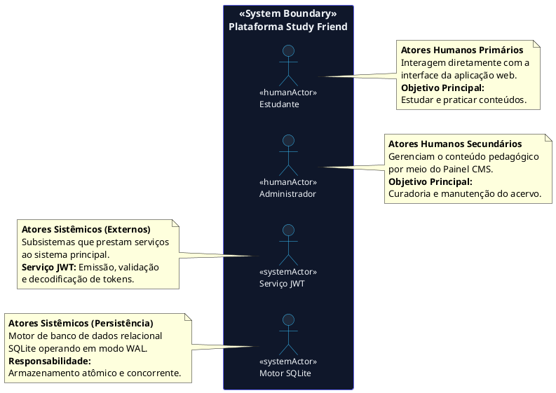
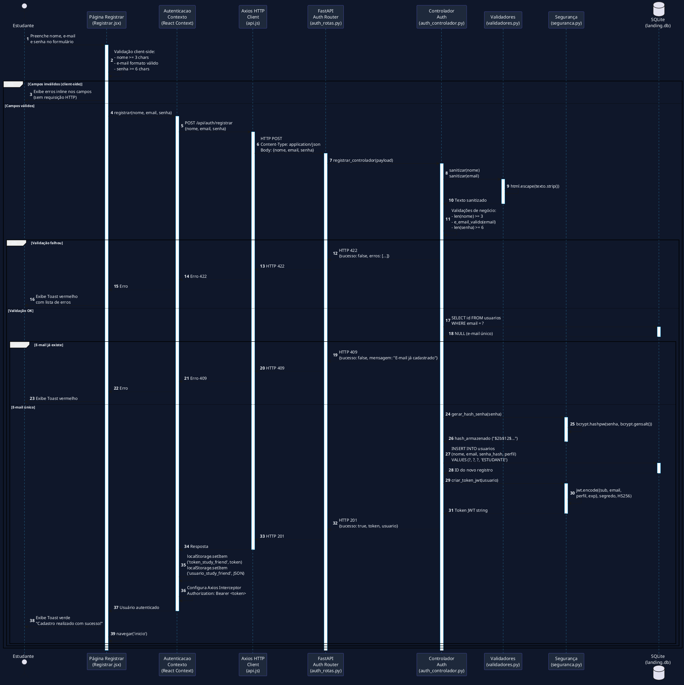
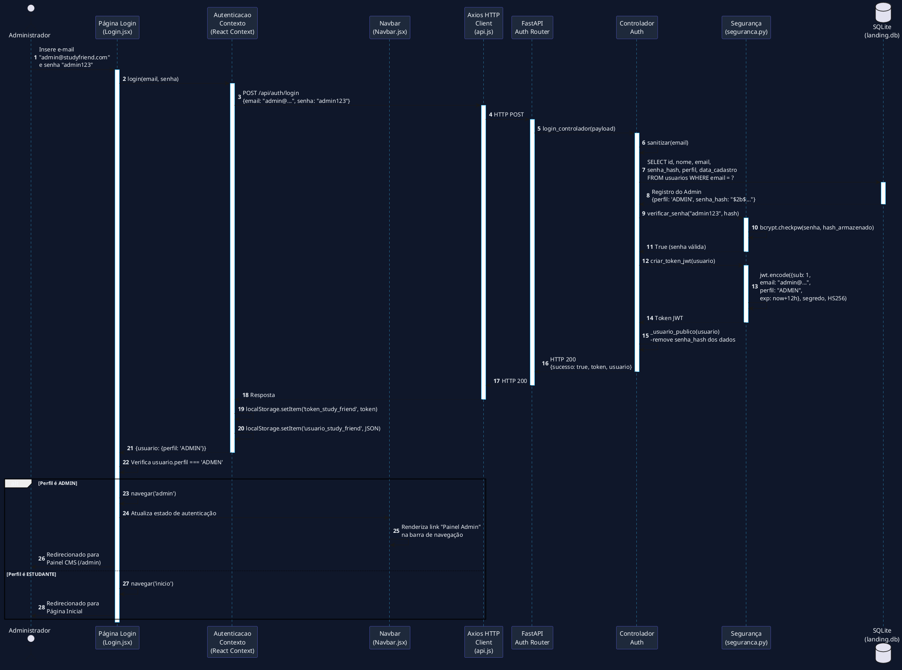
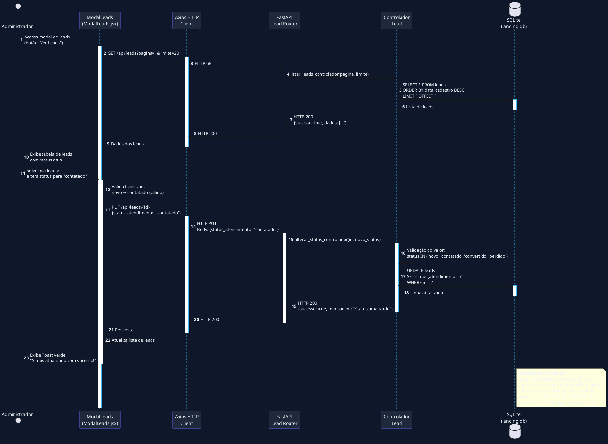
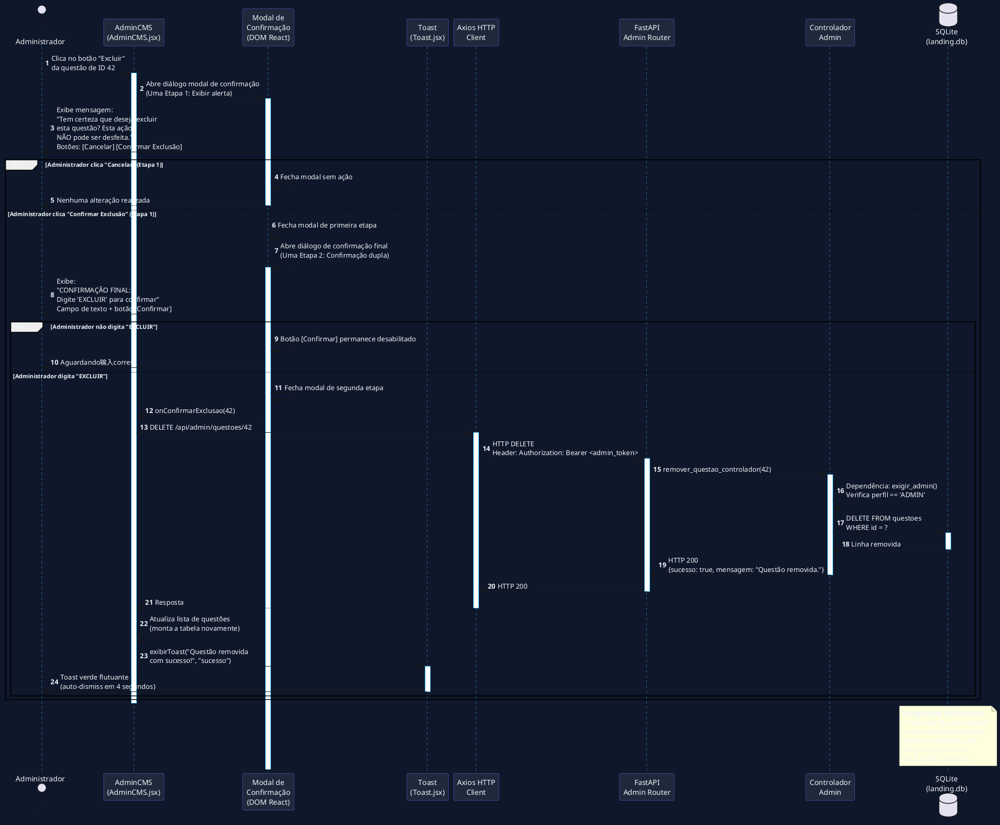

# Especificação de Requisitos de Usuário (RU) — Study Friend

**Projeto:** Plataforma Estudantil Integrada *Study Friend*
**Padrão de Documentação:** ISO/IEC/IEEE 29148:2018 & UML 2.5.1 (ISO/IEC 19505)
**Modelo de Qualidade:** FURPS+ / ISO/IEC 25010
**Versão:** 2.0.0
**Data:** 03 de Setembro de 2026
**Status:** Aprovado / Baseline Técnica
**Autor:** Engenharia de Software & Arquitetura UML

---

## 1. Introdução e Contexto do Sistema

### 1.1 Propósito do Documento

Este documento especifica os **Requisitos de Usuário (RU)** e o **Modelo de Casos de Uso** para a plataforma **Study Friend**, em inteira conformidade com a especificação **UML 2.5.1 (ISO/IEC 19505)** e o padrão **ISO/IEC/IEEE 29148:2018** para documentos de requisitos de software. O objetivo é estabelecer o contrato comportamental e funcional entre as partes interessadas (*stakeholders*) e a equipe de desenvolvimento, servindo como referência imutável para verificação, validação e rastreabilidade durante todo o ciclo de vida do software.

### 1.2 Visão Geral do Sistema

O **Study Friend** é uma plataforma educacional web full-stack projetada para otimizar a preparação pedagógica de alunos do Ensino Médio e candidatos ao ENEM/Vestibulares. A arquitetura é composta por:

- **Frontend:** React 18 (componentes funcionais com Hooks `useState`, `useEffect`, `useContext`), Vite (build tool com HMR), Tailwind CSS v3 (utilitários CSS Mobile-First), tema escuro minimalista com acento ciano.
- **Backend:** Python 3 + FastAPI (framework async de alta performance), Uvicorn (servidor ASGI).
- **Persistência:** SQLite com modo WAL (*Write-Ahead Logging*) e *Prepared Statements*.
- **Segurança:** PyJWT (autenticação stateless), bcrypt (hashing de senhas), sanitização via `html.escape`.

O sistema consolida **9 disciplinas do Ensino Médio** estruturadas em **4 áreas de conhecimento separadas** — Exatas, Humanas, Biológicas e Linguagens — cada uma com **ícone identificador** por disciplina, e organizadas por anos escolares, oferecendo:

- Resumos didáticos em formato Markdown com suporte a mapas mentais (PDF);
- Módulo de revisão ativa utilizando *flashcards* com animação tridimensional (Flip 3D);
- Banco de exercícios interativo de múltipla escolha com gabarito comentado;
- Painel analítico (*Dashboard*) de acompanhamento estatístico de desempenho por disciplina;
- Painel Administrativo (*CMS*) seguro para gestão descentralizada do acervo pedagógico.

### 1.3 Escopo de Aplicação

O sistema é destinado ao uso público de estudantes brasileiros do Ensino Médio (1º, 2º e 3º ano) e pré-vestibulandos que desejam praticar conteúdos das 9 disciplinas obrigatórias: Matemática, Física, Química, História, Geografia, Filosofia, Sociologia, Biologia e Língua Portuguesa e Literatura. As disciplinas são agrupadas em áreas separadas (**Exatas**, **Humanas**, **Biológicas** e **Linguagens**) e cada uma possui um ícone próprio para facilitar a identificação visual.

### 1.4 Referências Normativas

| Norma | Descrição |
|:------|:----------|
| ISO/IEC/IEEE 29148:2018 | Engenharia de Requisitos — Modelos de Documentos |
| UML 2.5.1 (ISO/IEC 19505) | Linguagem de Modelagem Unificada |
| ISO/IEC 25010:2023 | Modelo de Qualidade de Software |
| FURPS+ | Modelo de Requisitos Não-Funcionais (Functionality, Usability, Reliability, Performance, Supportability) |

---

## 2. Taxonomia de Atores (UML 2.5.1 Actor Specification)

Conforme a especificação UML 2.5.1, um **Ator** (*Actor*) define um papel desempenhado por uma entidade externa que interage diretamente com o sistema sob estudo (*Subject*). Atores são classificados em **Humanos Primários**, **Humanos Secundários** e **Sistêmicos**.

### 2.1 Diagrama de Hierarquia de Atores (PlantUML)



### 2.2 Caracterização dos Atores Humanos (`<<humanActor>>`)

#### 2.2.1 Estudante (Ator Humano Primário)

| Propriedade | Descrição |
|:------------|:----------|
| **Nome** | Estudante |
| **Estereótipo** | `<<humanActor>>` |
| **Classificação** | Ator Primário (iniciador de Casos de Uso) |
| **Descrição** | Usuário final primário da plataforma. Estudante do Ensino Médio (1º, 2º ou 3º ano) ou pré-vestibulando. |
| **Objetivos** | Navegar pelas disciplinas, visualizar resumos e mapas mentais, praticar retenção com *flashcards*, resolver questões de múltipla escolha e monitorar sua taxa de rendimento no *dashboard*. |
| **Perfil de Acesso** | `ESTUDANTE` — autenticado via JWT. |
| **Motivação** | Melhorar desempenho em provas do ENEM/Vestibulares por meio de estudo ativo e acompanhamento estatístico de evolução. |
| **Pontos de Interação** | Páginas públicas (início, disciplinas, tópicos, resumos, flashcards), área autenticada (exercícios, dashboard), formulários de login/cadastro. |

#### 2.2.2 Administrador (Ator Humano Secundário)

| Propriedade | Descrição |
|:------------|:----------|
| **Nome** | Administrador |
| **Estereótipo** | `<<humanActor>>` |
| **Classificação** | Ator Secundário (usuário de suporte ao processo) |
| **Descrição** | Usuário gestor responsável pela curadoria pedagógica e manutenção do catálogo de dados do sistema (CMS). |
| **Objetivos** | Cadastrar, editar, atualizar e remover disciplinas, tópicos, resumos, baralhos de *flashcards* e questões de múltipla escolha. |
| **Perfil de Acesso** | `ADMIN` — autenticado via JWT com verificação de `perfil == 'ADMIN'` em middleware. |
| **Motivação** | Manter o conteúdo pedagógico atualizado, correto e completo para os estudantes. |
| **Pontos de Interação** | Painel CMS (`/admin`) com interface de abas para gerenciamento CRUD de todas as entidades. |

#### 2.2.3 Usuário (Classe Abstrata de Ator)

| Propriedade | Descrição |
|:------------|:----------|
| **Nome** | Usuário |
| **Estereótipo** | `<<abstract>>` |
| **Descrição** | Classe abstrata que generaliza todos os atores humanos autenticados. Possui atributos básicos de identidade: ID, Nome, E-mail, Hash de Senha, Perfil de Acesso, Data de Cadastro. |
| **Especializações** | `Estudante`, `Administrador` |

### 2.3 Caracterização dos Atores Sistêmicos (`<<systemActor>>`)

#### 2.3.1 Serviço de Autenticação JWT

| Propriedade | Descrição |
|:------------|:----------|
| **Nome** | Serviço JWT |
| **Estereótipo** | `<<systemActor>>` |
| **Classificação** | Ator Sistêmico (serviço externo) |
| **Descrição** | Subsistema (módulo `seguranca.py`) responsável por emitir, validar e decodificar tokens JSON Web Token (JWT) utilizando o algoritmo HS256. |
| **Responsabilidades** | Geração de token com *claims* `sub` (ID do usuário), `email`, `perfil` e `exp` (expiração de 12 horas); verificação de assinatura digital; validação de expiração. |
| **Dependências** | Biblioteca `PyJWT`, variável de ambiente `SEGREDO_JWT`. |

#### 2.3.2 Motor de Persistência SQLite

| Propriedade | Descrição |
|:------------|:----------|
| **Nome** | Motor SQLite |
| **Estereótipo** | `<<systemActor>>` |
| **Classificação** | Ator Sistêmico (serviço de persistência) |
| **Descrição** | Banco de dados relacional embarcado, operando em modo WAL (*Write-Ahead Logging*), responsável pelo armazenamento atômico das entidades e histórico de progresso do aluno. |
| **Responsabilidades** | Execução de *Prepared Statements* (consultas parametrizadas com `?`), garantia de integridade referencial via *Foreign Key Constraints*, suporte a concorrência de leitura simultânea. |
| **Configurações** | `PRAGMA journal_mode = WAL`, `PRAGMA foreign_keys = ON`, `row_factory = dict`. |

---

## 3. Catálogo de Requisitos de Usuário (RU)

Os requisitos a seguir estão categorizados por módulos funcionais e seguem a codificação padronizada `RU-[MODULO]-[NUMERO]`. Cada requisito é classificado pela prioridade **MoSCoW** (Must, Should, Could, Won't).

### 3.1 Módulo de Autenticação e Gestão de Perfil (RU-AUTH)

| ID | Título | Descrição | Prioridade | Ator Principal | Caso de Uso |
|:---|:-------|:----------|:-----------|:---------------|:------------|
| **RU-AUTH-01** | Cadastro de Estudante | O sistema deve permitir que um visitante cadastre uma conta de estudante fornecendo nome (≥3 caracteres), e-mail válido e senha (≥6 caracteres). | **Must** | Estudante | UC-02 |
| **RU-AUTH-02** | Autenticação por E-mail e Senha | O sistema deve autenticar usuários cadastrados por e-mail e senha, retornando um token JWT válido para manutenção da sessão por 12 horas. | **Must** | Usuário | UC-01 |
| **RU-AUTH-03** | Controle de Acesso Baseado em Papéis (RBAC) | O sistema deve restringir o acesso ao Painel Admin (CMS) exclusivamente a usuários com perfil `ADMIN`, retornando HTTP 403 para não autorizados. | **Must** | Administrador | UC-03 |
| **RU-AUTH-04** | Encerramento de Sessão (*Logout*) | O sistema deve permitir que o usuário invalide localmente credenciais ativas (remove token do `localStorage`) e encerre a sessão com segurança. | **Should** | Usuário | UC-01 |
| **RU-AUTH-05** | Validação de Token no Carregamento | O sistema deve restaurar automaticamente a sessão do usuário a partir do `localStorage` ao carregar a aplicação, validando a presença do token armazenado. | **Should** | Usuário | UC-03 |

### 3.2 Módulo de Conteúdo e Navegação Pedagógica (RU-CONT)

| ID | Título | Descrição | Prioridade | Ator Principal | Caso de Uso |
|:---|:-------|:----------|:-----------|:---------------|:------------|
| **RU-CONT-01** | Catálogo de Disciplinas | O sistema deve disponibilizar um Hub com as 9 disciplinas do Ensino Médio, agrupadas por área de conhecimento separada (Exatas, Humanas, Biológicas e Linguagens), exibindo nome, ícone identificador, área do conhecimento e contagem de tópicos vinculados. | **Must** | Estudante | UC-04 |
| **RU-CONT-02** | Filtragem de Tópicos por Ano Escolar | O sistema deve permitir a filtragem dos tópicos de uma disciplina por ano escolar (1º Ano, 2º Ano, 3º Ano ou ENEM). | **Must** | Estudante | UC-04 |
| **RU-CONT-03** | Visualização de Resumos Didáticos | O sistema deve renderizar resumos conceituais formatados em sintaxe Markdown, exibindo negrito, listas e formatação de texto. | **Must** | Estudante | UC-05 |
| **RU-CONT-04** | Acesso a Mapas Mentais | O sistema deve fornecer links externos diretos para mapas mentais complementares em formato PDF, quando disponíveis. | **Could** | Estudante | UC-05 |
| **RU-CONT-05** | Exibição de Contadores de Conteúdo | O sistema deve exibir a quantidade de resumos, flashcards e questões disponíveis para cada tópico listado. | **Should** | Estudante | UC-04 |

### 3.3 Módulo de Revisão Ativa por Flashcards (RU-CARD)

| ID | Título | Descrição | Prioridade | Ator Principal | Caso de Uso |
|:---|:-------|:----------|:-----------|:---------------|:------------|
| **RU-CARD-01** | Estudo de Baralhos de Flashcards | O sistema deve apresentar cartões interativos de revisão por tópico com pergunta (frente) e resposta (verso). | **Must** | Estudante | UC-06 |
| **RU-CARD-02** | Animação Flip 3D | O sistema deve permitir ao estudante virar o cartão por meio de interação visual tridimensional com transformação CSS `rotateY(180deg)`, `preserve-3d` e `backface-visibility: hidden`. | **Should** | Estudante | UC-06 |
| **RU-CARD-03** | Navegação Sequencial de Cartões | O sistema deve permitir avançar e retroceder entre os flashcards de um determinado baralho por meio de botões de navegação. | **Should** | Estudante | UC-06 |
| **RU-CARD-04** | Indicador de Posição no Baralho | O sistema deve exibir o número do cartão atual e o total de cartões do baralho (ex: "3 de 12"). | **Could** | Estudante | UC-06 |

### 3.4 Módulo de Banco de Exercícios e Prática (RU-EXER)

| ID | Título | Descrição | Prioridade | Ator Principal | Caso de Uso |
|:---|:-------|:----------|:-----------|:---------------|:------------|
| **RU-EXER-01** | Filtragem Dinâmica de Exercícios | O sistema deve permitir filtrar questões por disciplina, ano escolar e grau de dificuldade (Fácil, Médio, Difícil), combinando filtros opcionalmente. | **Must** | Estudante | UC-07 |
| **RU-EXER-02** | Submissão e Validação de Resposta | O sistema deve permitir selecionar uma alternativa (A–E), registrar a resposta do aluno e indicar imediatamente o acerto ou erro com feedback visual colorido (verde/vermelho). | **Must** | Estudante | UC-07, UC-08 |
| **RU-EXER-03** | Exibição de Gabarito Comentado | O sistema deve exibir a explicação detalhada do gabarito após a confirmação da resposta do aluno, permitindo aprendizado correto. | **Must** | Estudante | UC-07 |
| **RU-EXER-04** | Atualização de Progresso | O sistema deve registrar/atualizar automaticamente o progresso do aluno (acerto/erro) ao responder uma questão, usando operação *UPSERT* para re-respostas. | **Must** | Estudante | UC-08 |
| **RU-EXER-05** | Proteção da Resposta Correta | O sistema não deve expor a alternativa correta antes da submissão da resposta pelo aluno. | **Must** | Estudante | UC-07 |

### 3.5 Módulo de Acompanhamento de Desempenho (RU-DASH)

| ID | Título | Descrição | Prioridade | Ator Principal | Caso de Uso |
|:---|:-------|:----------|:-----------|:---------------|:------------|
| **RU-DASH-01** | Dashboard de Estatísticas do Aluno | O sistema deve apresentar um painel gráfico com o histórico do estudante, exibindo total de questões resolvidas, total de acertos, total de erros e taxa de acerto (%). | **Must** | Estudante | UC-09 |
| **RU-DASH-02** | Desempenho Categorizado por Disciplina | O sistema deve detalhar visualmente a porcentagem de aproveitamento individualizada para cada uma das 9 disciplinas, exibindo barras de progresso horizontais. | **Should** | Estudante | UC-09 |
| **RU-DASH-03** | Acesso Restrito a Dados Próprios | O sistema deve exibir apenas as estatísticas do estudante autenticado, garantindo isolamento de dados entre usuários diferentes. | **Must** | Estudante | UC-09 |

### 3.6 Módulo de Gestão Administrativa CMS (RU-ADMIN)

| ID | Título | Descrição | Prioridade | Ator Principal | Caso de Uso |
|:---|:-------|:----------|:-----------|:---------------|:------------|
| **RU-ADMIN-01** | Gestão de Disciplinas | O sistema deve permitir cadastrar, listar, atualizar e excluir disciplinas (nome e área do conhecimento) por meio de interface de abas no Painel CMS. | **Must** | Administrador | UC-10 |
| **RU-ADMIN-02** | Gestão de Tópicos | O sistema deve permitir criar, listar, editar e excluir tópicos associados a uma disciplina e ano escolar (1, 2, 3 ou ENEM). | **Must** | Administrador | UC-11 |
| **RU-ADMIN-03** | Gestão de Resumos | O sistema deve disponibilizar formulário para cadastro e edição de resumos em Markdown, com vinculação a tópico e opção de anexação de links de mapas mentais (PDF). | **Must** | Administrador | UC-12 |
| **RU-ADMIN-04** | Gestão de Flashcards | O sistema deve permitir incluir, listar, editar e remover pares de pergunta/resposta (frente/verso) no baralho de flashcards, vinculados a um tópico. | **Must** | Administrador | UC-13 |
| **RU-ADMIN-05** | Gestão do Banco de Questões | O sistema deve permitir o cadastro de questões com enunciado, opções de múltipla escolha (A–E armazenadas como JSON), alternativa correta, gabarito comentado e nível de dificuldade. | **Must** | Administrador | UC-14 |
| **RU-ADMIN-06** | Notificação de Sucesso/Erro | O sistema deve exibir notificações visuais (*Toast*) após cada operação de criação, atualização ou exclusão no CMS, informando sucesso ou erro da operação. | **Should** | Administrador | UC-10–UC-14 |
| **RU-ADMIN-07** | Confirmação de Exclusão | O sistema deve exibir um diálogo modal de confirmação antes de executar a exclusão de qualquer registro no CMS, prevenindo exclusões acidentais. | **Should** | Administrador | UC-10–UC-14 |

---

## 4. Especificação de Casos de Uso (UML 2.5.1 Use Case Specifications)

### 4.1 Diagrama de Casos de Uso Geral do Sistema (PlantUML)

```plantuml
@startuml
left to right direction
skinparam packageStyle rectangle
skinparam shadowing false
skinparam monochrome false

skinparam actor {
  BackgroundColor #1e293b
  BorderColor #38bdf8
  FontColor #f1f5f9
  FontSize 13
}

skinparam rectangle {
  BackgroundColor #0f172a
  BorderColor #6366f1
  FontColor #f1f5f9
}

skinparam usecase {
  BackgroundColor #1e3a5f
  BorderColor #38bdf8
  FontColor #f1f5f9
  FontSize 11
}

skinparam package {
  BackgroundColor #0f172a
  BorderColor #818cf8
  FontColor #c4b5fd
  FontSize 12
}

actor "<<humanActor>>\nEstudante" as est
actor "<<humanActor>>\nAdministrador" as adm
actor "<<systemActor>>\nServiço JWT" as jwt
actor "<<systemActor>>\nMotor SQLite" as db

rectangle "<<System Boundary>>\nPlataforma Study Friend" {

  package "Autenticação" {
    usecase "UC-01: Autenticar\nUsuário no Sistema" as UC01
    usecase "UC-02: Cadastrar\nNovo Estudante" as UC02
    usecase "UC-03: Validar Token\nJWT e Perfil" as UC03
    usecase "UC-04: Encerrar\nSessão (Logout)" as UC04B
  }

  package "Área Pedagógica" {
    usecase "UC-05: Consultar\nDisciplinas e Tópicos" as UC05
    usecase "UC-06: Visualizar\nResumo Didático" as UC06
    usecase "UC-07: Praticar com\nFlashcards" as UC07
    usecase "UC-08: Filtrar Questões\ndo Banco de Exercícios" as UC08B
    usecase "UC-09: Resolver Questão\ne Submeter Resposta" as UC09
    usecase "UC-10: Registrar Resposta\ne Atualizar Progresso" as UC10
    usecase "UC-11: Consultar Dashboard\nde Desempenho" as UC11
  }

  package "Painel Administrativo (CMS)" {
    usecase "UC-12: Gerenciar\nDisciplinas" as UC12
    usecase "UC-13: Gerenciar\nTópicos" as UC13
    usecase "UC-14: Gerenciar\nResumos" as UC14
    usecase "UC-15: Gerenciar\nFlashcards" as UC15
    usecase "UC-16: Gerenciar Banco\nde Questões" as UC16
  }
}

' Relacionamentos do Estudante
est --> UC01
est --> UC02
est --> UC04B
est --> UC05
est --> UC06
est --> UC07
est --> UC08B
est --> UC09
est --> UC11

' Relacionamentos do Administrador
adm --> UC01
adm --> UC04B
adm --> UC12
adm --> UC13
adm --> UC14
adm --> UC15
adm --> UC16

' Relacionamentos UML <<include>> e <<extend>>
UC01 .> UC03 : <<include>>
UC09 .> UC10 : <<include>>
UC06 <.. UC05 : <<extend>>
{condition = "Seleção de Tópico"}
UC07 <.. UC05 : <<extend>>
{condition = "Modo Flashcard"}
UC11 <.. UC09 : <<extend>>
{condition = "Após Responder"}

' Atores Secundários
UC03 -- jwt
UC10 -- db

@enduml
```

### 4.2 Descrição Detalhada dos Casos de Uso

#### UC-01: Autenticar Usuário no Sistema

| Campo | Especificação |
|:------|:--------------|
| **Identificador** | `UC-01` |
| **Nome** | Autenticar Usuário no Sistema |
| **Atores** | `Usuário` (Iniciador / Primário), `Serviço JWT` (Secundário) |
| **Descrição** | Permite que Estudantes ou Administradores realizem login na plataforma para obter credenciais de acesso JWT. |
| **Pré-condições** | O usuário deve possuir uma conta ativa cadastrada no banco de dados `usuarios`. |
| **Pós-condições (Sucesso)** | Um token JWT válido é armazenado no `localStorage` (`token_study_friend`) e no contexto React (`AutenticacaoContexto`). O usuário é redirecionado para a área logada. |
| **Pós-condições (Falha)** | Nenhuma alteração de estado. Mensagem de erro exibida ao usuário. |
| **Relacionamentos UML** | `<<include>>` → `UC-03: Validar Token JWT e Perfil` (sempre que autenticação é bem-sucedida). |

**Fluxo Principal de Eventos:**

| Etapa | Ação | Ator/Componente |
|:------|:-----|:----------------|
| 1 | O usuário acessa a página de Login (`/login`). | Estudante |
| 2 | O usuário insere e-mail e senha nos campos do formulário. | Estudante |
| 3 | O frontend valida a presença e sintaxe dos campos (client-side). | React (Login.jsx) |
| 4 | O formulário é submetido via `POST /api/auth/login` com payload `{email, senha}`. | Axios (api.js) |
| 5 | O backend sanitiza o e-mail com `html.escape()` antes da consulta. | FastAPI (auth_controlador.py) |
| 6 | O backend consulta o e-mail na tabela `usuarios` usando *Prepared Statement* (`?`). | SQLite |
| 7 | O backend verifica o hash bcrypt da senha informada com `bcrypt.checkpw()`. | seguranca.py |
| 8 | O `Serviço JWT` gera o token codificado contendo `sub` (ID do usuário), `email`, `perfil` e `exp` (12h). | seguranca.py |
| 9 | O backend retorna HTTP 200 OK com `{sucesso: true, token: "...", usuario: {...}}`. | FastAPI |
| 10 | O frontend armazena o token no `localStorage` como `token_study_friend` e o objeto do usuário como `usuario_study_friend`. | AutenticacaoContexto.jsx |
| 11 | O Axios Interceptor configura o cabeçalho `Authorization: Bearer <token>` para futuras requisições. | api.js |
| 12 | O sistema redireciona o usuário para a página inicial (`/`). | App.jsx |

**Fluxo Alternativo FA-01 — Redirecionamento Admin:**

| Etapa | Condição | Ação |
|:------|:---------|:-----|
| 12A | Na etapa 10, se `perfil === 'ADMIN'` | O frontend redireciona diretamente para a rota `/admin` em vez de `/`. |

**Fluxos de Exceção:**

| ID | Condição | Ação |
|:---|:---------|:-----|
| **FE-01** | E-mail não encontrado na tabela `usuarios` | O backend retorna HTTP 401 Unauthorized com `{sucesso: false, mensagem: "E-mail ou senha incorretos."}`. Mensagem genérica para evitar *enumeration attack*. |
| **FE-02** | Senha incorreta (`bcrypt.checkpw()` retorna `False`) | Mesmo retorno HTTP 401 com mensagem genérica. |
| **FE-03** | Campos obrigatórios ausentes no payload | Backend retorna HTTP 422 Unprocessable Entity. |

---

#### UC-02: Cadastrar Novo Estudante

| Campo | Especificação |
|:------|:--------------|
| **Identificador** | `UC-02` |
| **Nome** | Cadastrar Novo Estudante |
| **Atores** | `Estudante` (Iniciador / Primário) |
| **Descrição** | Permite que um visitante crie uma nova conta de estudante na plataforma. |
| **Pré-condições** | O visitante não possui conta ativa com o e-mail informado. |
| **Pós-condições** | Usuário criado com perfil `ESTUDANTE`, token JWT emitido e sessão iniciada. |

**Fluxo Principal de Eventos:**

| Etapa | Ação |
|:------|:-----|
| 1 | O visitante acessa a página de Cadastro (`/registrar`). |
| 2 | O visitante preenche nome (≥3 caracteres), e-mail válido e senha (≥6 caracteres). |
| 3 | O formulário é submetido via `POST /api/auth/registrar` com payload `{nome, email, senha}`. |
| 4 | O backend valida: nome ≥3 chars, e-mail por regex `^[a-zA-Z0-9._%+-]+@[a-zA-Z0-9.-]+\.[a-zA-Z]{2,}$`, senha ≥6 chars. |
| 5 | O backend verifica unicidade do e-mail na tabela `usuarios`. |
| 6 | Se e-mail duplicado, retorna HTTP 409 Conflict. |
| 7 | O backend gera hash bcrypt da senha e insere o registro com `perfil = 'ESTUDANTE'`. |
| 8 | O backend gera token JWT e retorna HTTP 201 Created com token e dados do usuário. |
| 9 | O frontend armazena token e usuário, redirecionando para `/`. |

**Fluxos de Exceção:**

| ID | Condição | Ação |
|:---|:---------|:-----|
| **FE-01** | Nome < 3 caracteres | HTTP 422 com erro descritivo. |
| **FE-02** | E-mail inválido (regex) | HTTP 422 com erro descritivo. |
| **FE-03** | Senha < 6 caracteres | HTTP 422 com erro descritivo. |
| **FE-04** | E-mail já cadastrado | HTTP 409 Conflict. |

---

#### UC-05: Consultar Disciplinas e Tópicos

| Campo | Especificação |
|:------|:--------------|
| **Identificador** | `UC-05` |
| **Nome** | Consultar Disciplinas e Tópicos |
| **Atores** | `Estudante` (Primário) |
| **Descrição** | Permite navegar pelo catálogo de 9 disciplinas (agrupadas em áreas separadas e exibidas com ícones), visualizar tópicos por ano escolar e acessar conteúdo associado. |
| **Pré-condições** | Nenhuma (rota pública). |
| **Pós-condições** | Dados de disciplinas/tópicos exibidos na interface. |

**Fluxo Principal de Eventos:**

| Etapa | Ação |
|:------|:-----|
| 1 | O estudante acessa a página inicial (`/`) ou Hub de Disciplinas (`/disciplinas`). |
| 2 | O frontend solicita `GET /api/disciplinas` para obter as 9 disciplinas (com ícone e contagem de tópicos). |
| 3 | O backend executa `LEFT JOIN` entre `disciplinas` e `topicos` para contar tópicos por disciplina. |
| 4 | O estudante seleciona uma disciplina, navegando para a página de tópicos. |
| 5 | O frontend solicita `GET /api/disciplinas/{id}/topicos?ano_escolar=X`. |
| 6 | O backend retorna os tópicos com subcontagens de resumos, flashcards e questões. |
| 7 | O estudante pode aplicar filtro por ano escolar (1, 2, 3 ou ENEM). |

---

#### UC-09: Resolver Questão e Submeter Resposta

| Campo | Especificação |
|:------|:--------------|
| **Identificador** | `UC-09` |
| **Nome** | Resolver Questão do Banco de Exercícios |
| **Atores** | `Estudante` (Primário), `Motor SQLite` (Secundário) |
| **Descrição** | Permite que o estudante selecione, responda a uma questão de múltipla escolha e visualize o gabarito comentado. |
| **Relacionamentos UML** | `<<include>>` → `UC-10: Registrar Resposta e Atualizar Progresso`. |
| **Pré-condições** | O estudante deve estar autenticado com token JWT válido. |
| **Pós-condições** | A resposta é contabilizada na tabela `progresso_aluno`, a estatística do aluno é atualizada e o gabarito comentado é exibido. |

**Fluxo Principal de Eventos:**

| Etapa | Ação |
|:------|:-----|
| 1 | O estudante navega até o Banco de Exercícios (`/exercicios`). |
| 2 | O frontend solicita `GET /api/questoes` com filtros opcionais (disciplina, ano, dificuldade). |
| 3 | O backend monta consulta dinâmica com `WHERE 1=1` e filtros combináveis via `?` parametrizados. |
| 4 | As questões são exibidas sem revelar a alternativa correta. |
| 5 | O estudante seleciona uma alternativa (A–E) para a questão atual. |
| 6 | O estudante clica em "Confirmar Resposta". |
| 7 | O frontend envia `POST /api/questoes/responder` com `{questao_id, alternativa}`. |
| 8 | O backend valida a alternativa (deve ser A, B, C, D ou E). |
| 9 | O backend busca `resposta_correta` e `gabarito_comentado` na tabela `questoes`. |
| 10 | O backend compara: `correta = (resposta_opcao == resposta_correta)`. |
| 11 | O backend executa `UPSERT` na tabela `progresso_aluno`: `INSERT ... ON CONFLICT(usuario_id, questao_id) DO UPDATE SET status_acerto = excluded.status_acerto, data_resolucao = datetime('now','localtime')`. |
| 12 | O backend retorna `{sucesso: true, correta: bool, alternativa_correta: "...", gabarito_comentado: "..."}`. |
| 13 | O frontend exibe banner verde (acerto) ou vermelho (erro) com o gabarito comentado. |

**Fluxos de Exceção:**

| ID | Condição | Ação |
|:---|:---------|:-----|
| **FE-01** | Token JWT inválido ou expirado | HTTP 401 Unauthorized. |
| **FE-02** | Questão não encontrada | HTTP 404 Not Found. |
| **FE-03** | Alternativa inválida (não é A–E) | HTTP 422 Unprocessable Entity. |

---

#### UC-11: Consultar Dashboard de Desempenho

| Campo | Especificação |
|:------|:--------------|
| **Identificador** | `UC-11` |
| **Nome** | Consultar Dashboard de Desempenho |
| **Atores** | `Estudante` (Primário) |
| **Descrição** | Exibe relatórios visuais e estatísticos da evolução do aluno por matéria. |
| **Pré-condições** | O estudante deve estar autenticado com token JWT válido. |
| **Pós-condições** | Dados analíticos compilados são renderizados na tela em formato de barras de progresso. |

**Fluxo Principal de Eventos:**

| Etapa | Ação |
|:------|:-----|
| 1 | O estudante clica no menu "Dashboard" (`/dashboard`). |
| 2 | O frontend envia `GET /api/aluno/estatisticas` com o token JWT no cabeçalho `Authorization: Bearer <token>`. |
| 3 | O backend valida o token via `obter_usuario_atual()` (dependency injection). |
| 4 | O backend calcula: total de questões respondidas, total de acertos, total de erros, taxa de acerto geral (%). |
| 5 | O backend agrupa por disciplina com `JOIN` entre `progresso_aluno`, `questoes`, `topicos` e `disciplinas`. |
| 6 | O backend retorna JSON com métricas gerais e array `por_disciplina`. |
| 7 | O frontend renderiza barras de progresso horizontais em tema escuro para cada disciplina com porcentagem de aproveitamento. |

---

#### UC-16: Gerenciar Banco de Questões (CMS)

| Campo | Especificação |
|:------|:--------------|
| **Identificador** | `UC-16` |
| **Nome** | Gerenciar Banco de Questões no Painel CMS |
| **Atores** | `Administrador` (Primário) |
| **Descrição** | Permite criar, atualizar e remover questões cadastradas no acervo do sistema. |
| **Pré-condições** | Administrador autenticado com token JWT e alegação de perfil `ADMIN`. |
| **Pós-condições** | Alterações no banco de dados SQLite são salvas com sucesso. |

**Fluxo Principal de Eventos:**

| Etapa | Ação |
|:------|:-----|
| 1 | O Administrador acessa a aba "Questões" no Painel CMS (`/admin`). |
| 2 | O frontend solicita `GET /api/admin/questoes` com token de administrador. |
| 3 | O backend valida o token E verifica `perfil == 'ADMIN'` (via `exigir_admin`). |
| 4 | O sistema exibe a tabela com as questões cadastradas (enunciado, tópico, disciplina, dificuldade). |
| 5 | O Administrador seleciona "Nova Questão". |
| 6 | O Administrador preenche: enunciado (≥10 chars), vincula ao tópico/disciplina, define dificuldade (FACIL/MEDIO/DIFICIL), insere opções (A–E), escolhe a correta e escreve gabarito comentado. |
| 7 | O formulário é submetido via `POST /api/admin/questoes`. |
| 8 | O backend sanitiza os textos com `html.escape()` e serializa opções para JSON. |
| 9 | O backend insere o registro na tabela `questoes`. |
| 10 | O sistema exibe notificação de sucesso (*Toast*) e atualiza a listagem. |

---

## 5. Histórias de Usuário com Critérios de Aceite (BDD / Gherkin)

### 5.1 Autenticação e Gestão de Perfil

#### HU-AUTH-01: Cadastro de Estudante

**Como** estudante do Ensino Médio,
**Quero** criar uma conta na plataforma Study Friend,
**Para que** eu possa acessar funcionalidades personalizadas como exercícios e dashboard.

**Critérios de Aceite (Gherkin):**

```gherkin
Cenário: Cadastro bem-sucedido com dados válidos
  Dado que o visitante está na página de cadastro
  Quando ele preenche o nome com "Maria Silva" (>= 3 caracteres)
  E preenche o e-mail com "maria@email.com" (formato válido)
  E preenche a senha com "senha123" (>= 6 caracteres)
  E clica no botão "Cadastrar"
  Então o sistema deve criar a conta com perfil "ESTUDANTE"
  E retornar um token JWT válido
  E redirecionar o estudante para a página inicial

Cenário: Tentativa de cadastro com e-mail duplicado
  Dado que o visitante está na página de cadastro
  Quando ele preenche o e-mail com "admin@studyfriend.com" (já cadastrado)
  E clica no botão "Cadastrar"
  Então o sistema deve retornar erro HTTP 409
  E exibir a mensagem "E-mail já cadastrado"

Cenário: Tentativa de cadastro com senha curta
  Dado que o visitante está na página de cadastro
  Quando ele preenche a senha com "123" (< 6 caracteres)
  E clica no botão "Cadastrar"
  Então o sistema deve retornar erro HTTP 422
  E exibir a mensagem "A senha deve ter pelo menos 6 caracteres"
```

#### HU-AUTH-02: Login e Autenticação

**Como** estudante ou administrador,
**Quero** fazer login com meu e-mail e senha,
**Para que** eu possa acessar minhas funcionalidades protegidas.

**Critérios de Aceite (Gherkin):**

```gherkin
Cenário: Login bem-sucedido como estudante
  Dado que o usuário está na página de login
  Quando ele insere o e-mail "maria@email.com"
  E insere a senha correta
  E clica em "Entrar"
  Então o sistema deve retornar HTTP 200 com um token JWT
  E armazenar o token no localStorage como "token_study_friend"
  E redirecionar para a página inicial

Cenário: Login bem-sucedido como administrador
  Dado que o administrador está na página de login
  Quando ele insere o e-mail "admin@studyfriend.com"
  E insere a senha "admin123"
  E clica em "Entrar"
  Então o sistema deve retornar HTTP 200 com token JWT
  E redirecionar diretamente para o Painel CMS (/admin)

Cenário: Tentativa de login com credenciais inválidas
  Dado que o usuário está na página de login
  Quando ele insere um e-mail não cadastrado
  E insere qualquer senha
  E clica em "Entrar"
  Então o sistema deve retornar HTTP 401
  E exibir a mensagem "E-mail ou senha incorretos"
```

### 5.2 Conteúdo e Navegação Pedagógica

#### HU-CONT-01: Visualização do Hub de Disciplinas

**Como** estudante,
**Quero** visualizar todas as 9 disciplinas do Ensino Médio, agrupadas por área (Exatas, Humanas, Biológicas e Linguagens) e com ícone identificador,
**Para que** eu possa escolher qual matéria estudar de forma intuitiva.

**Critérios de Aceite (Gherkin):**

```gherkin
Cenário: Carregamento do hub de disciplinas
  Dado que o estudante está na página inicial
  Quando a página é carregada
  Então o sistema deve exibir 9 cards de disciplina
  E cada card deve exibir o nome da disciplina, o ícone identificador, a área do conhecimento e o número de tópicos
  E as disciplinas devem estar agrupadas por área (Exatas, Humanas, Biológicas e Linguagens)
  E cada grupo de área deve exibir cor e título próprios
  E as disciplinas devem estar ordenadas alfabeticamente dentro de cada área

Cenário: Navegação para tópicos de uma disciplina
  Dado que o estudante está no hub de disciplinas
  Quando ele clica no card "Matemática"
  Então o sistema deve carregar a página de tópicos da disciplina
  E exibir os tópicos disponíveis para Matemática
```

#### HU-CONT-02: Filtragem de Tópicos por Ano Escolar

**Como** estudante,
**Quero** filtrar os tópicos por ano escolar (1º, 2º, 3º ou ENEM),
**Para que** eu possa estudar apenas conteúdos do meu ano.

**Critérios de Aceite (Gherkin):**

```gherkin
Cenário: Filtrar tópicos por 1º ano
  Dado que o estudante está na página de tópicos de Matemática
  Quando ele seleciona o filtro "1º Ano"
  Então o sistema deve exibir apenas os tópicos com ano_escolar = "1"
  E ocultar tópicos de outros anos

Cenário: Filtrar tópicos por ENEM
  Dado que o estudante está na página de tópicos de História
  Quando ele seleciona o filtro "ENEM"
  Então o sistema deve exibir apenas os tópicos com ano_escolar = "ENEM"
```

### 5.3 Flashcards

#### HU-CARD-01: Estudo com Flashcards

**Como** estudante,
**Quero** praticar revisão ativa com flashcards de um tópico,
**Para que** eu possa fixar o conteúdo de forma interativa.

**Critérios de Aceite (Gherkin):**

```gherkin
Cenário: Visualização e flip de flashcard
  Dado que o estudante está na página de flashcards do tópico "Funções e Gráficos"
  Quando a página é carregada
  Então o sistema deve exibir o primeiro flashcard com a pergunta (frente)
  E o número do cartão atual e o total ("1 de 3")
  Quando o estudante clica no cartão
  Então o cartão deve realizar animação Flip 3D (rotateY 180°)
  E exibir a resposta (verso)

Cenário: Navegação entre flashcards
  Dado que o estudante está visualizando o primeiro flashcard
  Quando ele clica no botão "Próximo"
  Então o sistema deve exibir o segundo flashcard
  E atualizar o contador para "2 de 3"
```

### 5.4 Banco de Exercícios

#### HU-EXER-01: Resolução de Questão

**Como** estudante autenticado,
**Quero** responder questões de múltipla escolha com filtros,
**Para que** eu possa praticar e monitorar meu desempenho.

**Critérios de Aceite (Gherkin):**

```gherkin
Cenário: Responder questão com sucesso (acerto)
  Dado que o estudante está autenticado na página de exercícios
  Quando ele filtra por disciplina "Física" e dificuldade "Fácil"
  E seleciona a alternativa correta para uma questão
  E clica em "Confirmar Resposta"
  Then o sistema deve exibir um banner verde indicando acerto
  E exibir o gabarito comentado da questão
  E registrar o progresso na tabela progresso_aluno com status "ACERTOU"

Cenário: Responder questão com erro
  Dado que o estudante está autenticado na página de exercícios
  Quando ele seleciona uma alternativa incorreta
  E clica em "Confirmar Resposta"
  Então o sistema deve exibir um banner vermelho indicando erro
  E exibir a alternativa correta e o gabarito comentado
  E registrar o progresso com status "ERROU"

Cenário: Tentativa sem autenticação
  Dado que o usuário NÃO está autenticado
  Quando ele tenta acessar a página de exercícios
  Then o sistema deve redirecionar para a página de login
```

### 5.5 Dashboard de Desempenho

#### HU-DASH-01: Visualização do Dashboard

**Como** estudante autenticado,
**Quero** visualizar meu desempenho por disciplina com barras de progresso,
**Para que** eu possa identificar minhas fragilidades.

**Critérios de Aceite (Gherkin):**

```gherkin
Cenário: Dashboard com dados de progresso
  Dado que o estudante "Maria" está autenticado
  E já respondeu 15 questões (12 acertos, 3 erros)
  Quando ele acessa a página Dashboard (/dashboard)
  Então o sistema deve exibir:
    | Métrica               | Valor esperado |
    | Total respondidas     | 15             |
    | Total acertos         | 12             |
    | Total erros           | 3              |
    | Taxa de acerto geral  | 80.0%          |
  E exibir barras de progresso para cada disciplina comRespondida

Cenário: Dashboard sem dados
  Dado que o estudante não respondeu nenhuma questão
  Quando ele acessa o Dashboard
  Então o sistema deve exibir "0" em todas as métricas
  E a taxa de acerto deve ser "0.0%"
```

### 5.6 Painel Administrativo CMS

#### HU-ADMIN-01: Gerenciamento CRUD no CMS

**Como** administrador autenticado,
**Quero** cadastrar, editar e excluir disciplinas, tópicos, resumos, flashcards e questões,
**Para que** o conteúdo pedagógico esteja sempre atualizado.

**Critérios de Aceite (Gherkin):**

```gherkin
Cenário: Criar nova disciplina
  Dado que o administrador está autenticado no Painel CMS
  Quando ele acessa a aba "Disciplinas"
  E clica em "Nova Disciplina"
  E preenche nome "Astronomia" e área "Exatas"
  E clica em "Salvar"
  Então o sistema deve criar a disciplina no banco
  E exibir notificação de sucesso (Toast)
  E atualizar a listagem

Cenário: Editar questão existente
  Dado que o administrador está na aba "Questões"
  Quando ele clica em "Editar" na questão 1
  E altera o enunciado para texto maior que 10 caracteres
  E clica em "Salvar"
  Então o sistema deve atualizar o registro no banco
  E exibir notificação de sucesso

Cenário: Excluir flashcard com confirmação
  Dado que o administrador está na aba "Flashcards"
  Quando ele clica em "Excluir" em um flashcard
  Então o sistema deve exibir um diálogo modal de confirmação
  Quando o administrador confirma a exclusão
  Então o flashcard deve ser removido do banco
  E a listagem deve ser atualizada
  E uma notificação de sucesso deve ser exibida

Cenário: Acesso negado a não-administrador
  Dado que um estudante comum está autenticado
  Quando ele tenta acessar a rota /api/admin/disciplinas
  Then o sistema deve retornar HTTP 403 Forbidden
  E exibir a mensagem "Acesso restrito ao perfil administrador"
```

---

## 6. Diagramas de Sequência (PlantUML) — Foco no Usuário

### 6.1 DS do Formulário Público com Validação Client-Side e Sanitização Assíncrona

Este diagrama representa o fluxo de cadastro de estudante com validação client-side, sanitização no backend e feedback via Toast/DOM.



### 6.2 DS do Fluxo de Login Administrativo com Sessão/Token e Redirecionamento



### 6.3 DS da Alteração Operacional de Status de Atendimento (Legado — Leads)

Este diagrama representa o fluxo de alteração de status de atendimento da tabela `leads`, que possui constraint `CHECK(status_atendimento IN ('novo','contatado','convertido','perdido'))`.



### 6.4 DS da Exclusão Segura com Diálogo Modal de Confirmação em Duas Etapas



---

## 7. Requisitos Não-Funcionais (RNF) — Modelo FURPS+ / ISO 25010

| ID | Categoria FURPS+ | Requisito | Critério de Aceitação | ISO 25010 |
|:---|:-----------------|:----------|:----------------------|:----------|
| **RNF-01** | **Performance** | Tempo de resposta das requisições GET deve ser < 150ms em 95% dos casos. | Medido via inspeção de rede no navegador (DevTools Network Tab). | Eficiência de Desempenho |
| **RNF-02** | **Segurança** | Senhas devem ser criptografadas com bcrypt (≥12 rounds) antes de persistir. | Nenhuma senha em texto claro na tabela `usuarios`. Verificação via inspeção direta do banco. | Segurança |
| **RNF-03** | **Segurança** | Todos os inputs de texto devem ser sanitizados contra XSS via `html.escape()` no backend. | Teste com payload `<script>alert('XSS')</script>` não deve ser armazenado renderizável. | Segurança |
| **RNF-04** | **Segurança** | Proteção contra SQL Injection via Prepared Statements (`?` parametrizados) em todas as consultas. | Nenhuma concatenação direta de strings em comandos SQL. Auditoria de código. | Segurança |
| **RNF-05** | **Usabilidade** | Interface deve implementar tema escuro minimalista, com superfícies em tons slate, acento ciano e tipografia Plus Jakarta Sans. | Verificação visual de conformidade de estilo e acessibilidade de contraste (WCAG 2.1 AA). | Usabilidade |
| **RNF-06** | **Usabilidade** | Layout deve ser completamente responsivo (*Mobile-First*), suportando telas a partir de 320px. | Teste em Chrome, Firefox, Edge e Safari com dimensões de 320px a 2560px. | Usabilidade |
| **RNF-07** | **Confiabilidade** | SQLite deve operar em modo WAL com `PRAGMA journal_mode = WAL` e `PRAGMA foreign_keys = ON`. | Verificação via script `conexao_banco.py`. Ausência de erros `database is locked` em acessos simultâneos. | Confiabilidade |
| **RNF-08** | **Performance** | Token JWT deve expirar em 12 horas. Refresh automático não é implementado (renovação manual). | Verificação de decodificação do token com `exp` claim. | Eficiência de Desempenho |
| **RNF-09** | **Suportabilidade** | Frontend React 18 deve ser construído com Vite para produção, servido via FastAPI como arquivos estáticos. | Verificação de `frontend/dist` gerado e servido na rota raiz. | Suportabilidade |
| **RNF-10** | **Funcionalidade** | CORS deve ser configurável via variável de ambiente `ORIGEM_PERMITIDA`. | Teste de requisições cross-origin com e sem a origem configurada. | Funcionalidade |

---

## 8. Matriz de Rastreabilidade (RU x UC x REST API)

A tabela abaixo mapeia a rastreabilidade bidirecional entre Requisitos de Usuário, Casos de Uso e Endpoints RESTful implementados no backend FastAPI.

| Requisito de Usuário | Caso de Uso UML | Endpoint API RESTful | Método HTTP | Autenticação |
|:---------------------|:----------------|:---------------------|:------------|:-------------|
| **RU-AUTH-01** | `UC-02` | `/api/auth/registrar` | `POST` | Público |
| **RU-AUTH-02** | `UC-01`, `UC-03` | `/api/auth/login` | `POST` | Público |
| **RU-AUTH-03** | `UC-03` | `/api/admin/*` | Todos | JWT + ADMIN |
| **RU-AUTH-04** | `UC-04B` | N/A (client-side) | — | — |
| **RU-CONT-01** | `UC-05` | `/api/disciplinas` | `GET` | Público |
| **RU-CONT-02** | `UC-05` | `/api/disciplinas/{id}/topicos` | `GET` | Público |
| **RU-CONT-03** | `UC-06` | `/api/topicos/{id}/resumos` | `GET` | Público |
| **RU-CONT-04** | `UC-06` | `/api/topicos/{id}/resumos` | `GET` | Público |
| **RU-CARD-01** | `UC-07` | `/api/topicos/{id}/flashcards` | `GET` | Público |
| **RU-EXER-01** | `UC-08B` | `/api/questoes` | `GET` | Público |
| **RU-EXER-02** | `UC-09`, `UC-10` | `/api/questoes/responder` | `POST` | JWT (ESTUDANTE/ADMIN) |
| **RU-EXER-03** | `UC-09` | `/api/questoes/responder` | `POST` | JWT (ESTUDANTE/ADMIN) |
| **RU-EXER-04** | `UC-10` | `/api/questoes/responder` | `POST` | JWT (ESTUDANTE/ADMIN) |
| **RU-DASH-01** | `UC-11` | `/api/aluno/estatisticas` | `GET` | JWT (ESTUDANTE/ADMIN) |
| **RU-DASH-02** | `UC-11` | `/api/aluno/estatisticas` | `GET` | JWT (ESTUDANTE/ADMIN) |
| **RU-ADMIN-01** | `UC-12` | `/api/admin/disciplinas` | `GET`, `POST`, `PUT`, `DELETE` | JWT + ADMIN |
| **RU-ADMIN-02** | `UC-13` | `/api/admin/topicos` | `GET`, `POST`, `PUT`, `DELETE` | JWT + ADMIN |
| **RU-ADMIN-03** | `UC-14` | `/api/admin/resumos` | `GET`, `POST`, `PUT`, `DELETE` | JWT + ADMIN |
| **RU-ADMIN-04** | `UC-15` | `/api/admin/flashcards` | `GET`, `POST`, `PUT`, `DELETE` | JWT + ADMIN |
| **RU-ADMIN-05** | `UC-16` | `/api/admin/questoes` | `GET`, `POST`, `PUT`, `DELETE` | JWT + ADMIN |

---

## 9. Conclusão e Aprovação

Este documento estabelece a especificação formal de requisitos de usuário e modelos comportamentais da plataforma **Study Friend**. As especificações aqui descritas servem como guia arquitetural para os componentes frontend (React 18/Vite/Tailwind CSS) e backend (FastAPI/SQLite), garantindo rastreabilidade técnica e integridade dos processos de software de acordo com as normas **UML 2.5.1**, **ISO/IEC/IEEE 29148:2018** e o modelo de qualidade **FURPS+ / ISO/IEC 25010**.

| Ação | Responsável | Data |
|:-----|:------------|:-----|
| Elaboração do Documento | Engenharia de Software | 03/09/2026 |
| Revisão Técnica | Arquiteto de Software | — |
| Aprovação | Stakeholders / Product Owner | — |
