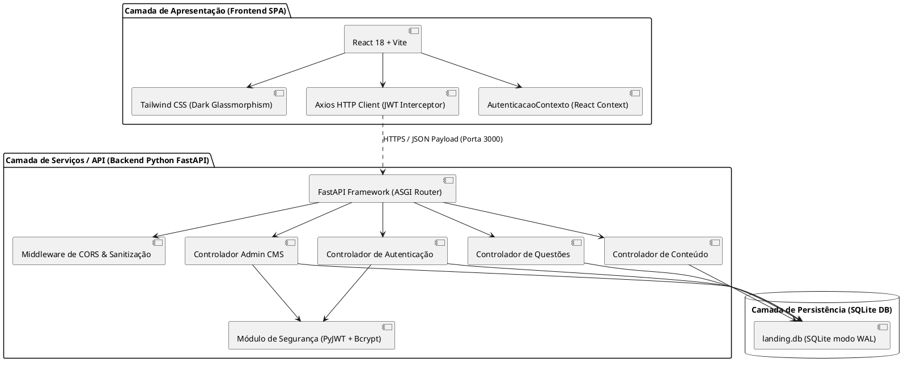
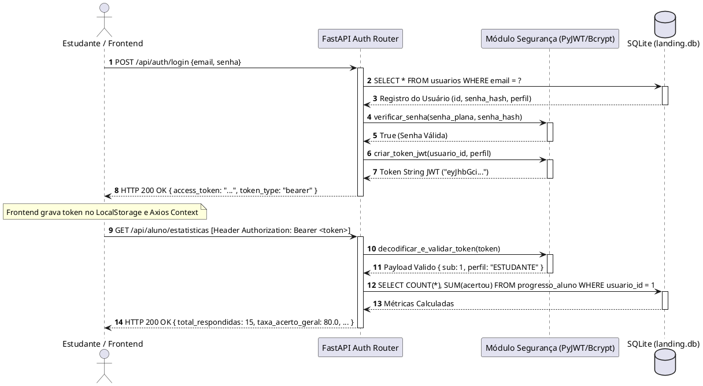

# ⚙️ Especificação de Requisitos de Sistema (RS) — Study Friend

**Projeto:** Plataforma Estudantil Integrada *Study Friend*  
**Padrão de Documentação:** ISO/IEC/IEEE 29148:2018 & UML 2.5.1 (ISO/IEC 19505)  
**Documento Complementar:** Especificação de Requisitos de Usuário (RU) v1.0.0  
**Versão:** 1.0.0  
**Data:** 01 de Setembro de 2026  
**Status:** Aprovado / Baseline de Arquitetura e Engenharia  
**Autor:** Engenharia de Software & Arquitetura UML  

---

## 1. Introdução e Visão Geral da Arquitetura do Sistema

### 1.1 Propósito do Documento
Este documento especifica os **Requisitos de Sistema (RS)** para a aplicação **Study Friend**. Enquanto o documento de Requisitos de Usuário (RU) estabelece as necessidades sob a ótica dos *stakeholders* (estudantes e administradores), esta Especificação de Requisitos de Sistema especifica rigorosamente o comportamento interno, restrições técnicas, contratos de interface REST, esquema de dados relacionais e artefatos de modelagem **UML 2.5.1** necessários para a implementação, testes e homologação do software.

### 1.2 Visão Arquitetural do Sistema (UML 2.5.1 Component Diagram)

A arquitetura do **Study Friend** adota o padrão cliente-servidor desacoplado com navegação *Single Page Application* (SPA) no frontend e uma *Web API RESTful Stateless* assíncrona no backend.



---

## 2. Requisitos Funcionais do Sistema (RFS)

Os Requisitos Funcionais do Sistema (RFS) detalham o comportamento lógico e as operações computacionais executadas pelo software.

### 2.1 Módulo de Autenticação e Segurança (`RFS-AUTH`)

* **`RFS-AUTH-01` — Registro de Novo Usuário:**
  * **Descrição:** O sistema deve fornecer endpoint `POST /api/auth/registrar` que receba `nome`, `email` e `senha`.
  * **Regras de Negócio:**
    * O e-mail deve ser único na tabela `usuarios`. Caso exista, retornar HTTP `400 Bad Request`.
    * A senha deve ser criptografada utilizando o algoritmo `bcrypt` com *salt* gerado automaticamente antes de persistir no banco.
    * O perfil padrão de novos registros deve ser fixado como `ESTUDANTE`.

* **`RFS-AUTH-02` — Autenticação e Emissão de Token JWT:**
  * **Descrição:** O sistema deve fornecer endpoint `POST /api/auth/login` que valide as credenciais recebidas (`email` e `senha`).
  * **Regras de Negócio:**
    * Verificar se o usuário existe e se a senha informada corresponde ao hash `bcrypt` salvo.
    * Em caso de sucesso, emitir um token JWT assinado digitalmente contendo as *claims*: `sub` (ID do usuário), `email`, `perfil` (`ESTUDANTE` ou `ADMIN`), `exp` (data de expiração).
    * Em caso de falha, retornar HTTP `401 Unauthorized` com mensagem genérica "E-mail ou senha incorretos".

* **`RFS-AUTH-03` — Interceptação e Injeção de Token no Frontend:**
  * **Descrição:** A instância `Axios` no frontend deve utilizar um *Interceptor de Requisição* para anexar automaticamente o cabeçalho `Authorization: Bearer <token>` em todas as chamadas para rotas protegidas.

* **`RFS-AUTH-04` — Autorização Baseada em Middleware (RBAC):**
  * **Descrição:** O backend FastAPI deve utilizar a injeção de dependências (`dependencias.py`) para inspecionar o token JWT nas requisições.
  * **Regras de Negócio:**
    * Rotas da API `/api/admin/*` devem exigir obrigatoriamente `perfil == 'ADMIN'`.
    * Se o token for inválido/expirado, retornar HTTP `401 Unauthorized`.
    * Se o token for válido mas o usuário não for `ADMIN`, retornar HTTP `403 Forbidden`.

---

### 2.2 Módulo de Conteúdo e Navegação Pedagógica (`RFS-CONT`)

* **`RFS-CONT-01` — Listagem do Hub de Disciplinas:**
  * **Descrição:** O endpoint `GET /api/disciplinas` deve retornar a lista das 9 disciplinas cadastradas (Matemática, Física, Química, História, Geografia, Filosofia, Sociologia, Biologia, Língua Portuguesa), incluindo a contagem agregada de tópicos cadastrados em cada uma (`COUNT(topicos.id)`).

* **`RFS-CONT-02` — Consulta e Filtragem de Tópicos:**
  * **Descrição:** O endpoint `GET /api/disciplinas/{id}/topicos` deve retornar os tópicos da disciplina informada.
  * **Parâmetros de Query:** Aceitar parâmetro opcional `?ano=` (valores aceitos: `'1'`, `'2'`, `'3'`, `'ENEM'`).

* **`RFS-CONT-03** — Leitura de Resumos e Links de Mapas Mentais:**
  * **Descrição:** O endpoint `GET /api/topicos/{id}/resumos` deve retornar o texto completo do resumo formatado em sintaxe Markdown e o link absoluto/relativo para o mapa mental em PDF.

---

### 2.3 Módulo de Flashcards Interativos (`RFS-CARD`)

* **`RFS-CARD-01` — Obtenção de Baralho por Tópico:**
  * **Descrição:** O endpoint `GET /api/topicos/{id}/flashcards` deve retornar a coleção de cartões contendo os campos `id`, `pergunta` e `resposta`.

* **`RFS-CARD-02` — Renderização e Animação CSS 3D:**
  * **Descrição:** O componente React `ModuloFlashcards.jsx` deve implementar a transformação CSS3 `transform: rotateY(180deg)` com `preserve-3d` e `backface-visibility: hidden` para alternar entre a frente (pergunta) e o verso (resposta) ao clique do usuário.

---

### 2.4 Módulo de Banco de Exercícios e Resolução (`RFS-EXER`)

* **`RFS-EXER-01` — Filtro Dinâmico de Questões:**
  * **Descrição:** O endpoint `GET /api/questoes` deve aceitar os seguintes parâmetros de filtro combináveis via query string:
    * `disciplina_id` (INTEGER)
    * `ano_escolar` (TEXT)
    * `dificuldade` (TEXT: 'Fácil', 'Médio', 'Difícil')
  * **Regras de Negócio:** As opções de resposta de múltipla escolha (A, B, C, D, E) devem ser retornadas sem indicar qual é a opção correta.

* **`RFS-EXER-02` — Submissão de Resposta e Verificação Atomica:**
  * **Descrição:** O endpoint `POST /api/questoes/responder` deve receber no body `{"questao_id": INT, "resposta_opcao": "A"|"B"|"C"|"D"|"E"}`.
  * **Processamento Interno:**
    1. Identificar o ID do aluno extraído do token JWT (`sub`).
    2. Buscar o gabarito oficial na tabela `questoes`.
    3. Comparar a resposta do aluno com o gabarito, calculando `correto = (resposta_opcao == gabarito)`.
    4. Gravar/Atualizar a tentativa na tabela `progresso_aluno` registrando `usuario_id`, `questao_id`, `resposta_opcao`, `acertou` (BOOLEAN) e `data_resposta` (TIMESTAMP).
    5. Retornar JSON no formato: `{"correto": bool, "opcao_correta": str, "explicacao": str}`.

---

### 2.5 Módulo de Analytics e Dashboard de Desempenho (`RFS-DASH`)

* **`RFS-DASH-01` — Cálculo de Estatísticas Individuais do Aluno:**
  * **Descrição:** O endpoint `GET /api/aluno/estatisticas` deve calcular estatísticas agregadas em tempo real com base no histórico do aluno logado (`usuario_id`).
  * **Métricas Retornadas:**
    * `total_respondidas`: Total único de questões respondidas pelo aluno.
    * `total_acertos`: Quantidade de questões onde `acertou == 1`.
    * `taxa_acerto_geral`: Porcentagem de acerto global (`(total_acertos / total_respondidas) * 100`).
    * `desempenho_por_disciplina`: Array contendo nome da disciplina, questões respondidas, acertos e porcentagem individual de aproveitamento.

---

### 2.6 Módulo Administrativo CMS (`RFS-ADMIN`)

* **`RFS-ADMIN-01` — Operações CRUD em Entidades Pedagogicas:**
  * **Descrição:** O sistema deve disponibilizar conjuntos completos de endpoints REST protegidos por middleware `perfil == ADMIN`:
    * Disciplinas: `GET`, `POST /api/admin/disciplinas`, `PUT/DELETE /api/admin/disciplinas/{id}`
    * Tópicos: `GET`, `POST /api/admin/topicos`, `PUT/DELETE /api/admin/topicos/{id}`
    * Resumos: `GET`, `POST /api/admin/resumos`, `PUT/DELETE /api/admin/resumos/{id}`
    * Flashcards: `GET`, `POST /api/admin/flashcards`, `PUT/DELETE /api/admin/flashcards/{id}`
    * Questões: `GET`, `POST /api/admin/questoes`, `PUT/DELETE /api/admin/questoes/{id}`
  * **Regras de Negócio:** Qualquer alteração ou exclusão deve garantir a integridade referencial por chave estrangeira (*Foreign Key Contraints*) no banco SQLite.

---

## 3. Especificação do Esquema de Dados Relacional (SQLite)

O banco de dados do sistema é mantido no arquivo `landing.db` utilizando SQLite operando com modo **WAL (Write-Ahead Logging)** e fábrica de linhas em formato de dicionário (`row_factory = sqlite3.Row`).

```plantuml
@startuml
entity "usuarios" as usuarios {
  * id : INTEGER <<PK, AutoIncrement>>
  --
  * nome : TEXT
  * email : TEXT <<UNIQUE>>
  * senha_hash : TEXT
  * perfil : TEXT <<'ESTUDANTE' | 'ADMIN'>>
  data_criacao : TIMESTAMP
}

entity "disciplinas" as disciplinas {
  * id : INTEGER <<PK, AutoIncrement>>
  --
  * nome : TEXT <<UNIQUE>>
  * area_conhecimento : TEXT
  icone : TEXT
}

entity "topicos" as topicos {
  * id : INTEGER <<PK, AutoIncrement>>
  --
  * disciplina_id : INTEGER <<FK>>
  * titulo : TEXT
  * ano_escolar : TEXT <<'1', '2', '3', 'ENEM'>>
  ordem : INTEGER
}

entity "resumos" as resumos {
  * id : INTEGER <<PK, AutoIncrement>>
  --
  * topico_id : INTEGER <<FK, UNIQUE>>
  * conteudo_md : TEXT
  url_mapa_mental_pdf : TEXT
}

entity "flashcards" as flashcards {
  * id : INTEGER <<PK, AutoIncrement>>
  --
  * topico_id : INTEGER <<FK>>
  * pergunta : TEXT
  * resposta : TEXT
}

entity "questoes" as questoes {
  * id : INTEGER <<PK, AutoIncrement>>
  --
  * topico_id : INTEGER <<FK>>
  * enunciado : TEXT
  * opcao_a : TEXT
  * opcao_b : TEXT
  * opcao_c : TEXT
  * opcao_d : TEXT
  * opcao_e : TEXT
  * opcao_correta : TEXT <<'A'|'B'|'C'|'D'|'E'>>
  * explicacao : TEXT
  dificuldade : TEXT <<'Fácil'|'Médio'|'Difícil'>>
}

entity "progresso_aluno" as progresso {
  * id : INTEGER <<PK, AutoIncrement>>
  --
  * usuario_id : INTEGER <<FK>>
  * questao_id : INTEGER <<FK>>
  * resposta_opcao : TEXT
  * acertou : BOOLEAN
  data_resposta : TIMESTAMP
}

disciplinas ||--o{ topicos : "possui"
topicos ||--o|| resumos : "detalha"
topicos ||--o{ flashcards : "contém"
topicos ||--o{ questoes : "agrupa"
usuarios ||--o{ progresso : "registra"
questoes ||--o{ progresso : "avaliada em"
@enduml
```

---

## 4. Modelagem Comportamental UML 2.5.1

### 4.1 Diagrama de Sequência: Autenticação de Usuário e Requisição Autorizada



---

### 4.2 Diagrama de Sequência: Resolução de Questão e Registro de Progresso

```plantuml
@startuml
autonumber
actor "Estudante" as user
participant "Componente BancoExercicios" as react
participant "FastAPI QuestaoRouter" as api
database "SQLite" as db

user -> react : Seleciona Alternativa ("C") e Clica em "Confirmar"
activate react

react -> api : POST /api/questoes/responder
Header: Bearer JWT
Body: { questao_id: 42, resposta_opcao: "C" }
activate api

api -> db : SELECT opcao_correta, explicacao FROM questoes WHERE id = 42
activate db
db --> api : { opcao_correta: "C", explicacao: "Justificativa..." }
deactivate db

note over api : Avalia acerto:
acertou = ("C" == "C") -> True

api -> db : INSERT INTO progresso_aluno (usuario_id, questao_id, resposta_opcao, acertou, data_resposta)
VALUES (1, 42, "C", 1, CURRENT_TIMESTAMP)
activate db
db --> api : OK (ID Inserido)
deactivate db

api --> react : HTTP 200 OK {
  correto: true,
  opcao_correta: "C",
  explicacao: "Justificativa..."
}
deactivate api

react -> user : Exibe Banner Verde (Acerto) e Abre Modal com Gabarito Comentado
deactivate react
@enduml
```

---

## 5. Requisitos Não-Funcionais do Sistema (RNFS)

### 5.1 Requisitos de Segurança (`RNFS-SEC`)
* **`RNFS-SEC-01` — Criptografia de Credenciais:** As senhas de usuários não devem ser legíveis sob nenhuma hipótese no banco de dados. Devem ser salvas como *hashes* gerados pelo algoritmo `bcrypt` com custo padrão mínimo de 12 rodadas (*rounds*).
* **`RNFS-SEC-02` — Proteção contra SQL Injection:** Todas as interações com o SQLite devem ser executadas por meio de *Prepared Statements* (consultas parametrizadas com `?`), proibindo a concatenação direta de strings em comandos SQL.
* **`RNFS-SEC-03` — Sanitização do Lado do Servidor (XSS):** Todos os campos de texto recebidos via requisições HTTP em formulários de cadastro ou administração do CMS devem ser filtrados utilizando `html.escape()` ou validados estritamente via esquemas `Pydantic` para prevenir ataques de *Cross-Site Scripting*.
* **`RNFS-SEC-04` — Política CORS (Cross-Origin Resource Sharing):** O servidor FastAPI deve configurar explicitamente o middleware CORS para permitir requisições apenas da origem autorizada do frontend (`http://localhost:5173` em ambiente de desenvolvimento).

### 5.2 Requisitos de Desempenho e Eficiência (`RNFS-PERF`)
* **`RNFS-PERF-01` — Latência de Endpoints de Leitura:** 95% das requisições do tipo `GET` em disciplinas, tópicos, resumos e questões devem retornar com tempo de resposta inferior a 150 milissegundos.
* **`RNFS-PERF-02` — Modo WAL do Banco de Dados:** O banco de dados SQLite deve ser inicializado obrigatoriamente com o comando `PRAGMA journal_mode=WAL;` (Write-Ahead Logging) e `PRAGMA synchronous=NORMAL;` para permitir leituras concorrentes simultâneas sem bloqueio do arquivo de banco.

### 5.3 Requisitos de Usabilidade e Interface (`RNFS-UX`)
* **`RNFS-UX-01` — Conformidade de Estilo Dark Glassmorphism:** A interface visual deve utilizar exclusivamente componentes configurados com opacidade reduzida, bordas suaves de tom ciano/slate, efeito `backdrop-blur` do CSS e fontes *Plus Jakarta Sans* (interface) e *Fira Code* (blocos de código).

---

## 6. Matriz de Rastreabilidade Bidirecional (RU x RFS x Entidade x Rota)

A tabela abaixo garante a rastreabilidade completa entre os **Requisitos de Usuário (RU)**, os **Requisitos de Sistema (RFS)**, as **Tabelas do Banco de Dados** e os **Endpoints da API FastAPI**.

| Requisito de Usuário (RU) | Requisito de Sistema (RFS) | Entidade de Dados (SQLite) | Endpoint API RESTful | Método HTTP |
| :--- | :--- | :--- | :--- | :--- |
| **RU-AUTH-01** | `RFS-AUTH-01` | `usuarios` | `/api/auth/registrar` | `POST` |
| **RU-AUTH-02** | `RFS-AUTH-02`, `RFS-AUTH-03` | `usuarios` | `/api/auth/login` | `POST` |
| **RU-AUTH-03** | `RFS-AUTH-04` | N/A (Middleware JWT) | `/api/admin/*` | Todos |
| **RU-CONT-01** | `RFS-CONT-01` | `disciplinas`, `topicos` | `/api/disciplinas` | `GET` |
| **RU-CONT-02** | `RFS-CONT-02` | `topicos` | `/api/disciplinas/{id}/topicos` | `GET` |
| **RU-CONT-03**, **RU-CONT-04** | `RFS-CONT-03` | `resumos` | `/api/topicos/{id}/resumos` | `GET` |
| **RU-CARD-01**, **RU-CARD-02** | `RFS-CARD-01`, `RFS-CARD-02` | `flashcards` | `/api/topicos/{id}/flashcards` | `GET` |
| **RU-EXER-01** | `RFS-EXER-01` | `questoes` | `/api/questoes` | `GET` |
| **RU-EXER-02**, **RU-EXER-03** | `RFS-EXER-02` | `questoes`, `progresso_aluno` | `/api/questoes/responder` | `POST` |
| **RU-DASH-01**, **RU-DASH-02** | `RFS-DASH-01` | `progresso_aluno`, `disciplinas` | `/api/aluno/estatisticas` | `GET` |
| **RU-ADMIN-01** | `RFS-ADMIN-01` | `disciplinas` | `/api/admin/disciplinas` | `GET`, `POST`, `PUT`, `DELETE` |
| **RU-ADMIN-02** | `RFS-ADMIN-01` | `topicos` | `/api/admin/topicos` | `GET`, `POST`, `PUT`, `DELETE` |
| **RU-ADMIN-03** | `RFS-ADMIN-01` | `resumos` | `/api/admin/resumos` | `GET`, `POST`, `PUT`, `DELETE` |
| **RU-ADMIN-04** | `RFS-ADMIN-01` | `flashcards` | `/api/admin/flashcards` | `GET`, `POST`, `PUT`, `DELETE` |
| **RU-ADMIN-05** | `RFS-ADMIN-01` | `questoes` | `/api/admin/questoes` | `GET`, `POST`, `PUT`, `DELETE` |

---

## 7. Homologação e Critérios de Aceite Arquitetural

1. **Aprovação de Cobertura de Testes:** Todas as rotas listadas na Matriz de Rastreabilidade devem possuir cobertura de testes de integração e testes unitários no backend.
2. **Execução em ModoWAL:** O ambiente de produção/desenvolvimento deve validar a integridade de gravações simultâneas sem a ocorrência de erros do tipo `database is locked`.
3. **Conformidade UML 2.5.1:** Todos os modelos de classe, componentes e sequência documentados nesta especificação correspondem com precisão de 1:1 ao código executável localizado no repositório do projeto.
